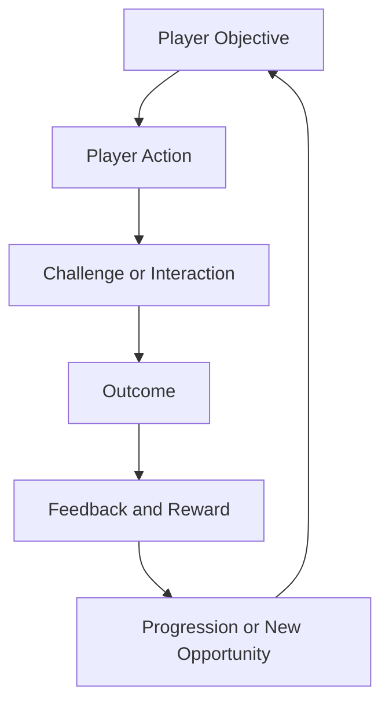
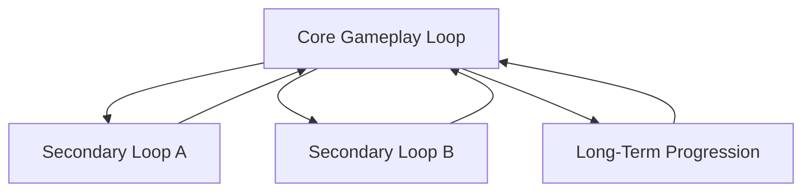

# Core Game Loop Document

> **Purpose:** Define the central gameplay cycle that forms the foundation of a game's interactive experience. This document describes what players repeatedly do, why they do it, how the game responds, and how each cycle contributes to the overall experience and progression.
>
> **Usage:** Copy this template into the game project's design documentation directory and customize it for that project. Complete it during concept development or prototyping, then refine it as the core gameplay is validated.

---

# 1. Document Information

| Field | Value |
|---|---|
| Project Name | [Game Name] |
| Document ID | GAMELOOP-001 |
| Document Title | Core Game Loop |
| Status | Draft |
| Version | 1.0 |
| Author | [Author] |
| Design Owner | [Responsible Person] |
| Creation Date | [YYYY-MM-DD] |
| Last Updated | [YYYY-MM-DD] |

## 1.1 Document Purpose

This document defines the core gameplay loop of **[Game Name]**.

It establishes the recurring sequence of player actions, game responses, challenges, outcomes, and rewards that creates the fundamental gameplay experience.

It serves as a reference for:

- Defining the central gameplay experience.
- Identifying the primary player actions.
- Establishing gameplay objectives and challenges.
- Designing feedback and reward mechanisms.
- Connecting individual mechanics into a coherent experience.
- Identifying dependencies between gameplay systems.
- Guiding prototypes and vertical slices.
- Evaluating whether new features support the core gameplay experience.

## 1.2 Scope

This document focuses on the central gameplay cycle and its relationship with supporting gameplay systems.

It does not replace:

- Core loop design guidelines.
- Gameplay design documentation.
- Individual mechanic specifications.
- Progression design documentation.
- Economy design documentation.
- Level design documentation.
- Narrative design documentation.
- Game balancing documentation.

Detailed system behavior should be documented separately when necessary.

---

# 2. Core Gameplay Overview

## 2.1 Core Gameplay Statement

Describe the fundamental experience the game offers.

Explain what the player primarily does, what motivates those actions, and what makes the experience worth repeating.

**Core Gameplay Statement:**

[Describe the central gameplay experience in one or two paragraphs.]

## 2.2 Core Loop Summary

Describe the central gameplay cycle in a concise sequence.

**Core Loop:**

1. [Player performs an initial action.]
2. [Game presents an objective, opportunity, or challenge.]
3. [Player makes a decision or performs an action.]
4. [Game evaluates the action and provides feedback.]
5. [Player receives an outcome, reward, or consequence.]
6. [The outcome creates the motivation or opportunity for another cycle.]

Adapt the sequence to match the actual game. Not every game requires all these steps or follows them in this order.

## 2.3 Core Loop Diagram

Represent the central gameplay cycle visually.

Replace the example with the actual gameplay sequence.

## 2.4 Core Loop Characteristics

| Attribute | Description |
|---|---|
| Primary Player Activity | [Main recurring activity] |
| Main Objective | [What the player tries to accomplish] |
| Main Challenge | [What makes the activity engaging or difficult] |
| Main Reward | [What the player gains] |
| Primary Motivation | [Why the player continues] |
| Typical Loop Duration | [Estimated duration] |
| Player Skill Involved | [Skills required or developed] |
| Expected Frequency | [How often the loop occurs] |

These values should be validated through prototypes and playtesting rather than treated as fixed assumptions.

---

# 3. Player Experience and Motivation

## 3.1 Target Player Experience

Describe the intended player experience while performing the core loop.

Consider:

- Emotions the player should experience.
- Decisions the player should make.
- Skills the player should develop.
- Challenges the player should overcome.
- Sense of accomplishment.
- Reasons to repeat the activity.

**Intended Experience:**

[Describe the intended experience.]

## 3.2 Player Motivation

Identify the motivations that encourage players to engage with the loop.

| Motivation | Description | How the Core Loop Supports It |
|---|---|---|
| [Motivation] | [Description] | [Supporting gameplay element] |
| [Motivation] | [Description] | [Supporting gameplay element] |
| [Motivation] | [Description] | [Supporting gameplay element] |

Possible motivations include:

- Mastery and skill improvement.
- Exploration and discovery.
- Achievement and completion.
- Resource acquisition.
- Character development.
- Narrative progression.
- Competition or cooperation.
- Creative expression.
- Risk-taking and experimentation.

## 3.3 Player Agency

Describe the decisions players can make during the loop.

Consider:

- Available actions.
- Alternative strategies.
- Risk and reward trade-offs.
- Resource allocation.
- Timing decisions.
- Optional objectives.
- Consequences of player choices.

**Player Agency:**

[Describe how players influence the outcome.]

## 3.4 Player Skill Development

Describe what players learn or improve through repeated interaction with the core loop.

| Skill | How It Is Developed | Gameplay Evidence |
|---|---|---|
| [Skill] | [Learning opportunity] | [Observable result] |
| [Skill] | [Learning opportunity] | [Observable result] |

---

# 4. Core Loop Breakdown

Break the core loop into its individual stages.

## 4.1 Stage 1: Initial Condition or Preparation

**Purpose:** [Why this stage exists.]

Describe the conditions that initiate the loop.

Consider:

- Player location or state.
- Available resources.
- Current objectives.
- Available equipment or abilities.
- Relevant world conditions.
- Information available to the player.

**Player Actions:**

- [Action]
- [Action]

**Game Response:**

[Describe how the game prepares or presents the activity.]

**Stage Exit Condition:**

[Describe what allows the player to proceed.]

## 4.2 Stage 2: Objective or Opportunity

**Purpose:** [Why this stage exists.]

Describe how the player identifies what they can accomplish.

Consider:

- Objectives.
- Opportunities.
- Discoveries.
- Tasks.
- Environmental cues.
- Available interactions.
- Optional activities.

**Player Actions:**

- [Action]
- [Action]

**Game Response:**

[Describe how the game communicates the objective or opportunity.]

**Stage Exit Condition:**

[Describe what allows the player to proceed.]

## 4.3 Stage 3: Player Action and Decision

**Purpose:** [Why this stage exists.]

Describe the primary actions and decisions players perform.

Consider:

- Controls and interactions.
- Available strategies.
- Mechanic usage.
- Resource consumption.
- Risk evaluation.
- Player skill.
- Alternative approaches.

**Player Actions:**

- [Action]
- [Action]

**Game Response:**

[Describe how the game processes player actions.]

**Stage Exit Condition:**

[Describe what allows the player to proceed.]

## 4.4 Stage 4: Challenge and Interaction

**Purpose:** [Why this stage exists.]

Describe the challenges, obstacles, and interactions that determine the outcome.

Consider:

- Enemies.
- Environmental obstacles.
- Puzzles.
- Resource limitations.
- Time constraints.
- Skill requirements.
- Random events.
- Other gameplay systems.

**Player Actions:**

- [Action]
- [Action]

**Game Response:**

[Describe how the game responds to the player's decisions and performance.]

**Stage Exit Condition:**

[Describe what allows the player to proceed.]

## 4.5 Stage 5: Outcome and Feedback

**Purpose:** [Why this stage exists.]

Describe how the game evaluates and communicates the result of the player's actions.

Possible outcomes:

- Success.
- Partial success.
- Failure.
- Progress.
- Resource loss.
- Discovery.
- Unlock.
- New opportunity.

**Player Feedback:**

- Visual feedback: [Description]
- Audio feedback: [Description]
- Gameplay feedback: [Description]
- Narrative feedback: [Description]

**Stage Exit Condition:**

[Describe what allows the player to proceed.]

## 4.6 Stage 6: Reward and Progression

**Purpose:** [Why this stage exists.]

Describe what the player receives or how the game changes after the activity.

Consider:

- Resources.
- Experience.
- Equipment.
- Abilities.
- Unlocks.
- Reputation.
- Information.
- Narrative progression.
- Access to new content.

**Rewards:**

[Describe the possible rewards.]

**Progression Impact:**

[Describe how the outcome affects future gameplay.]

**Stage Exit Condition:**

[Describe how the player returns to the next cycle or transitions elsewhere.]

---

# 5. Player Actions and Gameplay Mechanics

## 5.1 Primary Player Actions

Identify the actions that define the core gameplay experience.

| Action | Description | Purpose | Frequency |
|---|---|---|---|
| [Action] | [Description] | [Purpose] | [High / Medium / Low] |
| [Action] | [Description] | [Purpose] | [Frequency] |
| [Action] | [Description] | [Purpose] | [Frequency] |

## 5.2 Supporting Actions

Identify secondary actions that support the core loop.

| Action | Description | Relationship with Core Loop |
|---|---|---|
| [Action] | [Description] | [Relationship] |
| [Action] | [Description] | [Relationship] |

## 5.3 Required Mechanics

Identify the mechanics necessary for the loop to function.

| Mechanic | Purpose | Core Loop Stage | Specification Reference |
|---|---|---|---|
| [Mechanic] | [Purpose] | [Stage] | [Document reference] |
| [Mechanic] | [Purpose] | [Stage] | [Document reference] |

## 5.4 Player Decisions

Document meaningful decisions that influence the loop.

| Decision | Available Options | Consequences | Relevant Mechanics |
|---|---|---|---|
| [Decision] | [Options] | [Consequences] | [Mechanics] |
| [Decision] | [Options] | [Consequences] | [Mechanics] |

Decisions should have understandable consequences and should contribute to the intended player experience.

---

# 6. Challenges, Risks, and Failure

## 6.1 Core Challenges

Identify the primary challenges that make the loop engaging.

| Challenge | Description | Player Skill Required | Difficulty |
|---|---|---|---|
| [Challenge] | [Description] | [Skill] | [Low / Medium / High] |
| [Challenge] | [Description] | [Skill] | [Difficulty] |

## 6.2 Risk and Reward

Describe how risk influences player decisions.

| Risk | Potential Reward | Player Decision |
|---|---|---|
| [Risk] | [Reward] | [Decision] |
| [Risk] | [Reward] | [Decision] |

Consider:

- Potential losses.
- Potential gains.
- Recoverability.
- Resource investment.
- Difficulty.
- Optional versus mandatory risks.

## 6.3 Failure Conditions

Define how the player can fail during the core loop.

| Failure Condition | Consequence | Recovery Method |
|---|---|---|
| [Condition] | [Consequence] | [Recovery] |
| [Condition] | [Consequence] | [Recovery] |

## 6.4 Failure and Recovery Flow

Describe what happens after failure.

Consider:

- Immediate feedback.
- Lost resources or progress.
- Checkpoints.
- Retry opportunities.
- Recovery mechanics.
- Changes in difficulty.
- Return to the core loop.

**Recovery Design:**

[Describe the intended recovery experience.]

---

# 7. Rewards and Feedback

## 7.1 Reward Structure

Define the rewards associated with the core loop.

| Reward | Category | Acquisition Condition | Purpose |
|---|---|---|---|
| [Reward] | [Immediate / Long-term / Intrinsic / Extrinsic] | [Condition] | [Purpose] |
| [Reward] | [Category] | [Condition] | [Purpose] |

## 7.2 Immediate Feedback

Describe how the game communicates the immediate consequences of player actions.

Consider:

- Animation and visual effects.
- Sound effects.
- Interface updates.
- Character reactions.
- Environmental changes.
- Numerical feedback.
- Gameplay state changes.

## 7.3 Long-Term Feedback

Describe how repeated actions contribute to visible progress.

Consider:

- Character development.
- New abilities.
- Improved equipment.
- World changes.
- New areas.
- Narrative developments.
- Completion indicators.

## 7.4 Reward Frequency

Define the expected frequency of rewards.

| Reward Type | Expected Frequency | Intended Effect |
|---|---|---|
| Immediate | [Frequency] | [Effect] |
| Short-Term | [Frequency] | [Effect] |
| Long-Term | [Frequency] | [Effect] |

Reward frequency should be validated through playtesting and balancing.

---

# 8. Supporting Gameplay Loops

The core loop may depend on additional gameplay cycles that support or extend the central experience.

## 8.1 Secondary Loops

Identify secondary loops and explain their relationship with the core loop.

Examples include:

- Resource gathering.
- Crafting.
- Exploration.
- Combat preparation.
- Trading.
- Base building.
- Quest completion.
- Character progression.

| Secondary Loop | Main Activity | How It Supports the Core Loop | Frequency |
|---|---|---|---|
| [Loop] | [Activity] | [Relationship] | [Frequency] |
| [Loop] | [Activity] | [Relationship] | [Frequency] |

## 8.2 Secondary Loop Breakdown

For each important secondary loop, describe:

**Loop Name:** [Name]

**Purpose:** [Why it exists.]

**Sequence:**

1. [Player action.]
2. [Game response.]
3. [Outcome.]
4. [Reward or consequence.]
5. [Return condition.]

**Connection to Core Loop:**

[Explain how this loop contributes to the central gameplay experience.]

## 8.3 Meta Loop

If applicable, define the long-term cycle that operates across multiple core gameplay cycles or sessions.

Consider:

- Long-term progression.
- Permanent unlocks.
- Base or settlement development.
- Persistent resources.
- Campaign advancement.
- World state changes.
- Collection and completion.
- New gameplay opportunities.

**Meta Loop Description:**

[Describe the long-term gameplay cycle.]

## 8.4 Loop Relationships

Describe how the different gameplay loops interact.

Replace the example with the actual relationships. Do not include loops that are not part of the project.

---

# 9. Progression and Difficulty

## 9.1 Core Loop Progression

Describe how the core loop evolves as the player advances.

Consider:

- New mechanics.
- Increased complexity.
- New challenges.
- Additional choices.
- New environments.
- Expanded objectives.
- Improved player capabilities.
- Changes in available resources.

| Progression Stage | New Elements | Increased Complexity | Expected Player Development |
|---|---|---|---|
| [Stage] | [Elements] | [Complexity] | [Development] |
| [Stage] | [Elements] | [Complexity] | [Development] |

## 9.2 Difficulty Evolution

Describe how challenge changes throughout the game.

Consider:

- Enemy difficulty.
- Environmental complexity.
- Resource availability.
- Time pressure.
- Player skill requirements.
- Number of simultaneous challenges.
- Consequences of failure.

**Difficulty Direction:**

[Describe how difficulty evolves.]

## 9.3 Variety and Repetition

Define how repeated cycles remain engaging.

Consider:

- Different objectives.
- Randomized or variable encounters.
- Alternative strategies.
- Environmental variation.
- Player-driven decisions.
- New mechanics.
- Changing conditions.
- Optional challenges.

**Variety Strategy:**

[Describe how the game avoids repetitive or predictable gameplay.]

## 9.4 Long-Term Motivation

Explain why players should continue engaging with the core loop over extended play sessions.

**Long-Term Motivation:**

[Describe the intended motivation.]

---

# 10. Game States and Loop Transitions

## 10.1 Core Loop States

Identify the major game states involved in the core loop.

| State | Description | Entry Condition | Exit Condition |
|---|---|---|---|
| [State] | [Description] | [Condition] | [Condition] |
| [State] | [Description] | [Condition] | [Condition] |

## 10.2 Loop Transitions

Document important transitions between stages or states.

| Current State | Trigger | Next State | Expected Behavior |
|---|---|---|---|
| [State] | [Trigger] | [State] | [Behavior] |
| [State] | [Trigger] | [State] | [Behavior] |

## 10.3 Interruptions and Exceptions

Describe events that can interrupt the normal gameplay cycle.

Examples:

- Cutscenes.
- Dialogue.
- Player death.
- Pausing.
- Loading.
- Scripted events.
- Environmental transitions.
- Optional activities.

| Interruption | Trigger | Expected Behavior | Return Condition |
|---|---|---|---|
| [Interruption] | [Trigger] | [Behavior] | [Condition] |
| [Interruption] | [Trigger] | [Behavior] | [Condition] |

---

# 11. Economy and Resource Dependencies

Complete this section when resources, currencies, or consumable items influence the core loop.

## 11.1 Required Resources

| Resource | Purpose | Acquisition Method | Consumption Method |
|---|---|---|---|
| [Resource] | [Purpose] | [Method] | [Method] |
| [Resource] | [Purpose] | [Method] | [Method] |

## 11.2 Resource Flow

Describe how resources enter, move through, and leave the gameplay cycle.

Consider:

- Resource generation.
- Resource consumption.
- Storage.
- Conversion.
- Trading.
- Crafting.
- Rewards.
- Losses.

**Resource Flow Description:**

[Describe the resource flow.]

## 11.3 Resource Dependencies

Identify resources or systems that may limit the player's ability to continue the loop.

| Dependency | Impact on Core Loop | Potential Problem | Mitigation |
|---|---|---|---|
| [Dependency] | [Impact] | [Problem] | [Mitigation] |

---

# 12. Narrative and World Integration

## 12.1 Narrative Integration

Describe how the core loop supports the game's narrative.

Consider:

- Story progression.
- Character development.
- Worldbuilding.
- Environmental storytelling.
- Player choices.
- Narrative consequences.
- Story-related rewards.

**Narrative Integration:**

[Describe the relationship.]

## 12.2 World Interaction

Describe how the game world responds to the core loop.

Consider:

- Environmental changes.
- NPC reactions.
- Faction relationships.
- World events.
- Unlockable areas.
- Persistent consequences.
- Dynamic environments.

**World Interaction:**

[Describe the relationship.]

---

# 13. UX and Presentation

## 13.1 Player Information

Define what information players need to understand and perform the core loop.

| Information | Why It Is Needed | How It Is Communicated |
|---|---|---|
| [Information] | [Purpose] | [Visual / Audio / UI / Gameplay] |
| [Information] | [Purpose] | [Communication method] |

## 13.2 Gameplay Readability

Describe how the player recognizes:

- Available actions.
- Objectives.
- Threats.
- Opportunities.
- Successful actions.
- Failed actions.
- Rewards.
- Progression.

**Readability Requirements:**

[Describe requirements.]

## 13.3 Pacing

Describe the intended pacing of the core loop.

Consider:

- Action intensity.
- Decision-making time.
- Exploration periods.
- Rest and recovery.
- Difficulty peaks.
- Reward moments.
- Transitions between activities.

**Pacing Direction:**

[Describe the intended pacing.]

## 13.4 Accessibility Considerations

Identify accessibility requirements relevant to the core loop.

Consider:

- Input flexibility.
- Difficulty options.
- Clear gameplay feedback.
- Visual alternatives to audio cues.
- Audio alternatives to visual cues.
- Readability.
- Timing requirements.
- Repetitive input requirements.

---

# 14. Prototype and Validation

## 14.1 Core Loop Prototype

Describe the minimum playable implementation required to validate the core loop.

**Prototype Objective:**

[What must be demonstrated.]

**Required Components:**

- [Mechanic or system]
- [Mechanic or system]
- [Mechanic or system]

**Out of Scope:**

- [Feature not required for validation]
- [Feature not required for validation]

## 14.2 Validation Hypotheses

Define the assumptions that must be tested.

| ID | Hypothesis | Validation Method | Expected Evidence |
|---|---|---|---|
| LOOP-HYP-001 | [Hypothesis] | [Method] | [Evidence] |
| LOOP-HYP-002 | [Hypothesis] | [Method] | [Evidence] |

Examples:

- Players understand the primary objective without extensive explanation.
- The main action is engaging when repeated.
- Players can identify meaningful strategic choices.
- Rewards provide sufficient motivation to continue.
- The loop creates an appropriate balance between challenge and progress.

## 14.3 Playtesting Objectives

Define what should be evaluated during playtesting.

Consider:

- Player understanding.
- Engagement.
- Action clarity.
- Decision quality.
- Difficulty.
- Reward satisfaction.
- Repetition.
- Pacing.
- Frustration.
- Motivation to continue.

## 14.4 Success Criteria

Define measurable or observable criteria for validating the core loop.

| Criterion | Target or Expected Result | Measurement Method |
|---|---|---|
| Player Understanding | [Target] | [Method] |
| Engagement | [Target] | [Method] |
| Loop Completion | [Target] | [Method] |
| Decision Quality | [Target] | [Method] |
| Reward Satisfaction | [Target] | [Method] |
| Replay Motivation | [Target] | [Method] |

Targets should be appropriate for the game and supported by actual playtesting evidence.

## 14.5 Known Problems and Design Risks

Document unresolved problems or risks.

| ID | Problem or Risk | Impact | Proposed Action |
|---|---|---|---|
| LOOP-RISK-001 | [Description] | [Impact] | [Action] |
| LOOP-RISK-002 | [Description] | [Impact] | [Action] |

---

# 15. Implementation Dependencies

## 15.1 Required Gameplay Systems

Identify the systems required to support the core loop.

| System | Responsibility | Dependency | Status |
|---|---|---|---|
| [System] | [Responsibility] | [Dependency] | [Planned / In Progress / Complete] |
| [System] | [Responsibility] | [Dependency] | [Status] |

## 15.2 Feature Dependencies

Identify features that must exist before the core loop can function correctly.

| Feature | Dependency Type | Reason | Priority |
|---|---|---|---|
| [Feature] | [Required / Optional] | [Reason] | [Priority] |
| [Feature] | [Dependency Type] | [Reason] | [Priority] |

## 15.3 Technical Considerations

Document relevant technical considerations.

Consider:

- Scene transitions.
- Gameplay state management.
- Signal and event communication.
- Resource management.
- Save and load behavior.
- Randomization.
- AI behavior.
- Performance.
- Input handling.
- Audio and visual feedback.

Detailed implementation decisions belong in the project's technical documentation and architecture decision records.

---

# 16. AI-Assisted Design and Development

AI tools may support core loop exploration, mechanic brainstorming, prototype planning, documentation, and implementation.

AI-assisted work must follow these requirements:

1. Use this document as the authoritative reference for the approved core loop.
2. Preserve established gameplay objectives and design intent.
3. Distinguish approved mechanics from proposed alternatives.
4. Do not introduce additional loops without evaluating their contribution to the core experience.
5. Avoid adding complexity that does not improve player experience.
6. Identify assumptions that require prototyping or playtesting.
7. Do not invent playtesting results or claim that design hypotheses have been validated without evidence.
8. Do not change the approved core loop without project owner approval.
9. Keep detailed mechanic and system specifications in their appropriate project documents.
10. Validate implementation against the documented gameplay behavior.

## 16.1 AI Core Loop Reference

When asking an AI agent to work on the core loop, provide:

- This document.
- Relevant gameplay design documents.
- Approved mechanic specifications.
- Relevant progression and economy documentation.
- Existing implementation context.
- Known design constraints.
- Current validation results.

---

# 17. Design Change Management

Changes to the core gameplay loop may affect multiple mechanics, systems, progression structures, content requirements, and player expectations.

Significant changes should be evaluated before implementation.

Changes requiring review include:

- Primary player activities.
- Core objectives.
- Loop sequence.
- Main challenges.
- Reward structure.
- Failure and recovery behavior.
- Supporting gameplay loops.
- Progression relationships.
- Core gameplay dependencies.

| Field | Description |
|---|---|
| Change ID | LOOP-CHANGE-XXX |
| Description | [What is changing] |
| Reason | [Why the change is needed] |
| Affected Stages | [Affected loop stages] |
| Affected Systems | [Related mechanics and features] |
| Player Experience Impact | [Expected impact] |
| Production Impact | [Scope and implementation impact] |
| Decision | [Approved / Rejected / Deferred] |
| Owner | [Responsible Person] |
| Date | [YYYY-MM-DD] |

Preserve historical decisions where necessary and update affected project documentation.

---

# 18. Approval and Sign-Off

This document becomes the authoritative core gameplay loop reference once approved by the project owner or designated game design owner.

| Role | Name | Status | Date |
|---|---|---|---|
| Project Owner | [Name] | [Pending / Approved] | [Date] |
| Game Design Owner | [Name] | [Pending / Approved] | [Date] |

**Approval Notes:**

[Additional comments or conditions.]

---

# 19. Revision History

| Version | Date | Author | Description |
|---|---|---|---|
| 1.0 | [YYYY-MM-DD] | [Author] | Initial document creation. |

---

# 20. Related Documents

Reference the applicable documents in the game project and shared studio knowledge base.

- Core Loop Design Guidelines
- Gameplay Design Document
- Game Design Document
- Mechanic Design Documents
- Gameplay Design Guidelines
- Progression Design Document
- Economy Design Document
- Reward Design Document
- Difficulty Design Document
- Level Design Document
- Playtesting Guidelines
- Testing Strategy
- Documentation Standards

Use the actual repository paths when implementing this section. Do not add references to documents that do not exist in the project or shared studio repository.