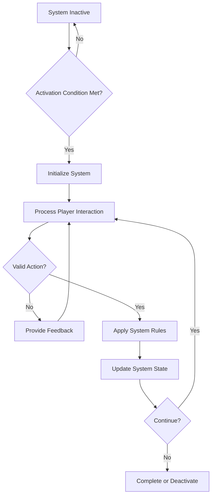
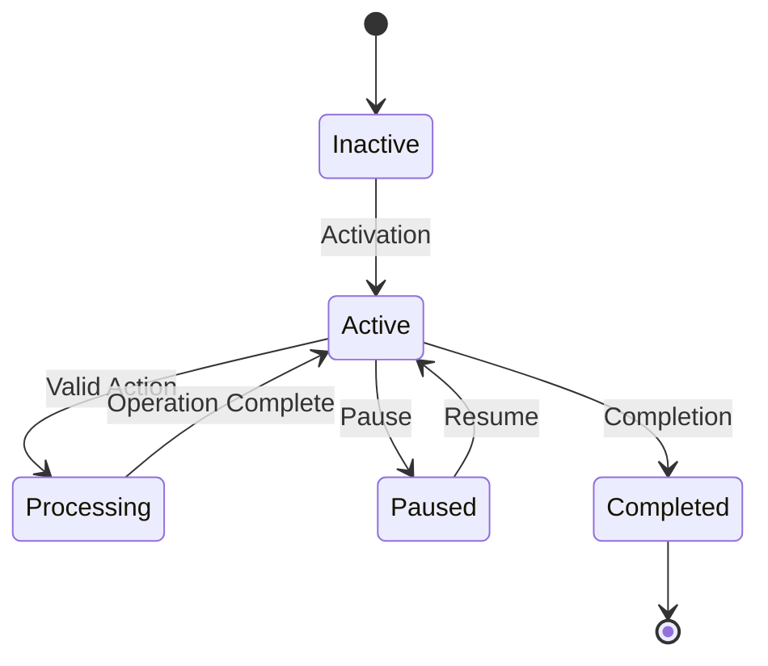
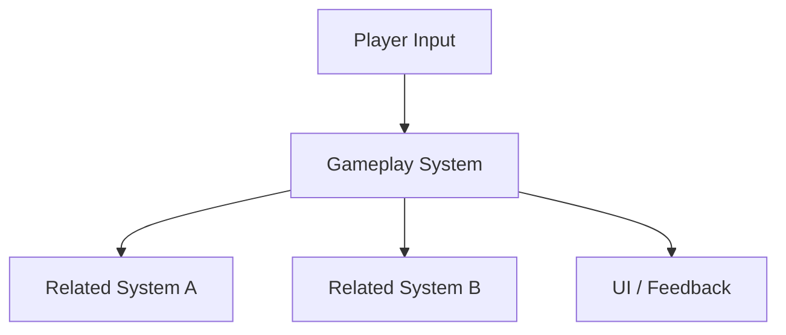

# Gameplay System Design Document

> **Purpose:** Define the design, behavior, rules, components, interactions, and requirements of an individual gameplay system. This document provides a shared reference for designing, implementing, testing, and maintaining the system.
>
> **Usage:** Copy this template into the game's project documentation directory and customize it for the specific system. Remove irrelevant sections and expand sections when necessary. Keep the document focused on one cohesive system. Separate complex subsystems into their own specifications and reference them here.

---

# 1. Document Information

| Field | Value |
|---|---|
| Project Name | [Game Name] |
| System ID | SYS-001 |
| System Name | [System Name] |
| Document Title | Gameplay System Design |
| Version | 1.0 |
| Status | Draft |
| Author | [Author] |
| Design Owner | [Responsible Person] |
| Technical Owner | [Responsible Person] |
| Creation Date | [YYYY-MM-DD] |
| Last Updated | [YYYY-MM-DD] |

## 1.1 Document Purpose

This document defines the design and expected behavior of the **[System Name]** gameplay system.

It establishes:

- The system's purpose and design intent.
- Its relationship to the overall game experience.
- The player interactions it supports.
- Its components and responsibilities.
- Its rules and constraints.
- Its states and transitions.
- Its interactions with other systems.
- Its expected behavior in normal and exceptional situations.
- Its validation and acceptance requirements.

## 1.2 Document Scope

**Included:**

- [Included responsibility]
- [Included responsibility]
- [Included responsibility]

**Excluded:**

- [Excluded responsibility]
- [Excluded responsibility]
- [Excluded responsibility]

## 1.3 Related Documents

| Document | Relationship |
|---|---|
| Game Design Document | Overall game design context |
| Game Vision | Intended player experience and creative direction |
| Core Pillars | Design commitments supported by the system |
| Core Gameplay Loop | How the system contributes to the gameplay cycle |
| Related Mechanic Specifications | Individual mechanics belonging to the system |
| Technical Architecture | Technical implementation constraints |
| Test Strategy | Testing approach and validation methods |

Add actual repository paths when implementing this section.

---

# 2. System Overview

## 2.1 System Summary

Describe the system in one or two paragraphs.

Explain:

- What the system does.
- Why it exists.
- What gameplay experience it provides.
- How players interact with it.
- How it contributes to the overall game.

**System Summary:**

[Describe the system.]

## 2.2 Design Intent

Explain the design goals behind the system.

Consider:

- Which player needs or motivations it supports.
- Which gameplay problems it solves.
- What makes the system interesting.
- What decisions it creates.
- How it reinforces the game's identity.

**Design Intent:**

[Describe the intended purpose.]

## 2.3 System Objectives

| ID | Objective | Description | Priority |
|---|---|---|---|
| SYS-OBJ-001 | [Objective] | [Description] | [Critical / High / Medium / Low] |
| SYS-OBJ-002 | [Objective] | [Description] | [Priority] |
| SYS-OBJ-003 | [Objective] | [Description] | [Priority] |

## 2.4 Player Experience

Describe what the player should experience when interacting with the system.

Consider:

- Expected player behavior.
- Important decisions.
- Feedback and responsiveness.
- Challenge and risk.
- Rewards and consequences.
- Emotional impact.

**Intended Experience:**

[Describe the player experience.]

## 2.5 Core Pillar Alignment

Identify which core pillars this system supports.

| Pillar ID | Pillar | Contribution |
|---|---|---|
| PILLAR-01 | [Pillar Name] | [How the system supports it] |
| PILLAR-02 | [Pillar Name] | [Contribution] |

---

# 3. System Boundaries

## 3.1 System Responsibilities

Define what the system owns and controls.

- [Responsibility]
- [Responsibility]
- [Responsibility]

## 3.2 System Non-Responsibilities

Identify what belongs to other systems.

- [Non-responsibility]
- [Non-responsibility]
- [Non-responsibility]

## 3.3 System Boundaries

Describe the limits of the system and how responsibilities are divided.

| Area | Owned by This System | Owned by Another System |
|---|---|---|
| [Area] | [Responsibilities] | [Other responsibilities] |
| [Area] | [Responsibilities] | [Other responsibilities] |

Avoid overlapping ownership of gameplay rules, persistent data, and important state.

## 3.4 System Entry and Exit Conditions

Describe when the system becomes active and when it stops operating.

**Entry Conditions:**

- [Condition]
- [Condition]

**Exit Conditions:**

- [Condition]
- [Condition]

---

# 4. Gameplay Flow

## 4.1 System Flow Overview

Describe the normal sequence of interactions within the system.

**Flow Description:**

[Describe the sequence from initial activation to completion.]

## 4.2 Gameplay Flow Diagram

Insert a flowchart showing the main system interactions.

Replace the example with a diagram appropriate to the actual system.

## 4.3 Main Interaction Sequence

| Step | Actor | Action | System Response | Result |
|---|---|---|---|---|
| 1 | [Actor] | [Action] | [Response] | [Result] |
| 2 | [Actor] | [Action] | [Response] | [Result] |
| 3 | [Actor] | [Action] | [Response] | [Result] |

## 4.4 Alternative Flows

Describe important alternative interaction paths.

| Scenario | Condition | Expected Behavior |
|---|---|---|
| [Scenario] | [Condition] | [Behavior] |
| [Scenario] | [Condition] | [Behavior] |

## 4.5 Interruptions and Cancellation

Describe what happens when the normal flow is interrupted.

Examples:

- Player leaves the interaction.
- Player receives damage.
- Player pauses the game.
- Another system takes control.
- The required resource becomes unavailable.
- The current activity is cancelled.
- The game changes scene or state.

**Interruption Rules:**

[Describe expected behavior.]

---

# 5. System Components

## 5.1 Component Overview

Identify the main components that make up the system.

| Component ID | Component | Responsibility | Dependencies |
|---|---|---|---|
| COMP-001 | [Component] | [Responsibility] | [Dependencies] |
| COMP-002 | [Component] | [Responsibility] | [Dependencies] |
| COMP-003 | [Component] | [Responsibility] | [Dependencies] |

## 5.2 Component Responsibilities

Describe each important component and its role.

### Component: [Component Name]

**Purpose:**

[Describe its purpose.]

**Responsibilities:**

- [Responsibility]
- [Responsibility]

**Inputs:**

- [Input]

**Outputs:**

- [Output]

**Dependencies:**

- [Dependency]

**Constraints:**

- [Constraint]

Repeat this section for components that require additional explanation.

## 5.3 Component Interactions

Describe how the components communicate and cooperate.

| Source Component | Target Component | Interaction | Purpose |
|---|---|---|---|
| [Component] | [Component] | [Interaction] | [Purpose] |
| [Component] | [Component] | [Interaction] | [Purpose] |

---

# 6. System Rules and Mechanics

## 6.1 Gameplay Rules

Define the rules that govern system behavior.

| Rule ID | Rule | Description | Priority |
|---|---|---|---|
| RULE-001 | [Rule] | [Description] | [Critical / High / Medium / Low] |
| RULE-002 | [Rule] | [Description] | [Priority] |
| RULE-003 | [Rule] | [Description] | [Priority] |

Rules should be unambiguous and testable where possible.

## 6.2 System Mechanics

List the mechanics that belong to this system.

| Mechanic ID | Mechanic | Description | Specification |
|---|---|---|---|
| MEC-001 | [Mechanic] | [Description] | [Document Reference] |
| MEC-002 | [Mechanic] | [Description] | [Document Reference] |

Individual mechanics with complex behavior should have dedicated mechanic specifications.

## 6.3 Inputs and Outputs

Describe the information and actions the system receives and produces.

**Inputs:**

| Input | Source | Description | Validation |
|---|---|---|---|
| [Input] | [Source] | [Description] | [Validation] |
| [Input] | [Source] | [Description] | [Validation] |

**Outputs:**

| Output | Destination | Description | Expected Result |
|---|---|---|---|
| [Output] | [Destination] | [Description] | [Result] |
| [Output] | [Destination] | [Description] | [Result] |

## 6.4 Preconditions

Define what must be true before an action or operation can occur.

- [Precondition]
- [Precondition]

## 6.5 Postconditions

Define the expected state after a successful operation.

- [Postcondition]
- [Postcondition]

## 6.6 Constraints and Limitations

Document gameplay limitations and restrictions.

- [Constraint]
- [Constraint]
- [Constraint]

---

# 7. System States and Transitions

## 7.1 State Overview

Identify the possible states of the system.

| State ID | State | Description |
|---|---|---|
| STATE-001 | [State] | [Description] |
| STATE-002 | [State] | [Description] |
| STATE-003 | [State] | [Description] |

## 7.2 State Transitions

Define the conditions that cause transitions.

| Current State | Trigger / Condition | Next State | Expected Behavior |
|---|---|---|---|
| [State] | [Trigger] | [State] | [Behavior] |
| [State] | [Trigger] | [State] | [Behavior] |

## 7.3 State Transition Diagram

Replace the example with the actual state model.

## 7.4 Invalid Transitions

Describe transitions that must not occur.

| Current State | Invalid Trigger | Expected Handling |
|---|---|---|
| [State] | [Trigger] | [Handling] |
| [State] | [Trigger] | [Handling] |

## 7.5 State Persistence

Describe which states must survive interruptions, scene changes, or game sessions.

| State / Data | Persistence Requirement | Reason |
|---|---|---|
| [State / Data] | [Persistent / Session / Temporary] | [Reason] |
| [State / Data] | [Requirement] | [Reason] |

Detailed save formats and serialization rules belong in the project's technical documentation.

---

# 8. Player Interaction and Feedback

## 8.1 Player Actions

List the actions available to the player through this system.

| Action | Input | Preconditions | Result |
|---|---|---|---|
| [Action] | [Input] | [Preconditions] | [Result] |
| [Action] | [Input] | [Preconditions] | [Result] |

## 8.2 Interaction Rules

Describe how the player initiates, performs, and completes interactions.

Consider:

- Input requirements.
- Interaction range.
- Timing.
- Target selection.
- Valid and invalid actions.
- Cancellation.
- Repeated input.
- Context-sensitive behavior.

**Interaction Rules:**

[Describe the rules.]

## 8.3 Feedback

Describe how the system communicates its state and responses.

| Event | Visual Feedback | Audio Feedback | UI / Other Feedback |
|---|---|---|---|
| [Event] | [Feedback] | [Feedback] | [Feedback] |
| [Event] | [Feedback] | [Feedback] | [Feedback] |

## 8.4 Responsiveness

Define expectations for system responsiveness.

Consider:

- Input response.
- Animation timing.
- Interaction delays.
- Feedback timing.
- Loading or processing delays.
- Interruptibility.

**Responsiveness Requirements:**

[Describe expected behavior.]

## 8.5 Accessibility

Identify relevant accessibility considerations.

- [Requirement]
- [Requirement]
- [Requirement]

---

# 9. System Data and Configuration

## 9.1 Data Overview

Identify the data required by the system.

| Data | Description | Type | Owner |
|---|---|---|---|
| [Data] | [Description] | [Data Type] | [System / Component] |
| [Data] | [Description] | [Data Type] | [Owner] |

## 9.2 Configuration

Identify values that should be configurable.

| Parameter | Description | Default | Valid Range | Configurable By |
|---|---|---|---|---|
| [Parameter] | [Description] | [Value] | [Range] | [Designer / Runtime / Other] |
| [Parameter] | [Description] | [Value] | [Range] | [Owner] |

Use appropriate configuration resources rather than unnecessarily hardcoding tunable gameplay values.

## 9.3 Runtime Data

Describe the temporary data maintained while the system is active.

[Describe runtime data and ownership.]

## 9.4 Persistent Data

Describe the data that must survive beyond the current gameplay session.

[Describe persistent data requirements.]

## 9.5 Data Validation

Describe how invalid or incomplete data should be handled.

- [Validation rule]
- [Default behavior]
- [Error handling]

---

# 10. Inter-System Dependencies

## 10.1 Dependencies

Identify systems required for this system to operate.

| Dependency | Purpose | Dependency Type | Failure Handling |
|---|---|---|---|
| [System] | [Purpose] | [Required / Optional] | [Handling] |
| [System] | [Purpose] | [Type] | [Handling] |

## 10.2 Systems Affected

Identify other systems that receive information or are affected by this system.

| System | Interaction | Impact |
|---|---|---|
| [System] | [Interaction] | [Impact] |
| [System] | [Interaction] | [Impact] |

## 10.3 Communication Rules

Describe how this system communicates with other systems.

Consider:

- Direct method calls.
- Signals and events.
- Shared resources.
- Data exchange.
- Ownership of shared state.
- Ordering requirements.

Follow the project's architecture and event/signal guidelines.

## 10.4 Dependency Diagram

Replace the example with the actual dependency relationships.

## 10.5 Failure and Degradation

Describe how the system should behave when dependencies are unavailable or fail.

[Describe expected behavior and recovery.]

---

# 11. Rules for Edge Cases and Exceptional Situations

Identify situations that could produce unexpected behavior.

| ID | Scenario | Expected Behavior | Priority |
|---|---|---|---|
| EDGE-001 | [Scenario] | [Expected behavior] | [Critical / High / Medium / Low] |
| EDGE-002 | [Scenario] | [Expected behavior] | [Priority] |
| EDGE-003 | [Scenario] | [Expected behavior] | [Priority] |

Consider:

- Invalid player input.
- Missing or unavailable resources.
- Interrupted interactions.
- Repeated actions.
- Conflicting system events.
- State changes during processing.
- Player death or defeat.
- Scene transitions.
- Save and load operations.
- Unexpected dependency failures.
- Boundary values.
- Multiplayer synchronization, if applicable.

## 11.1 Error Handling

Describe how errors and invalid operations should be handled.

| Error Condition | Expected Response | Player Feedback | Recovery |
|---|---|---|---|
| [Condition] | [Response] | [Feedback] | [Recovery] |
| [Condition] | [Response] | [Feedback] | [Recovery] |

## 11.2 Exploit Prevention

Identify possible exploits or unintended advantages.

| Potential Exploit | Impact | Prevention / Mitigation |
|---|---|---|
| [Exploit] | [Impact] | [Mitigation] |
| [Exploit] | [Impact] | [Mitigation] |

---

# 12. Balancing and Tuning

## 12.1 Balance Objectives

Describe the intended balance characteristics of the system.

Examples:

- Fairness.
- Meaningful decisions.
- Consistent rules.
- Appropriate challenge.
- Rewarding progression.
- Multiple viable strategies.

**Balance Objectives:**

[Describe the objectives.]

## 12.2 Tunable Parameters

Identify important gameplay values.

| Parameter | Current Value | Target / Range | Design Impact |
|---|---|---|---|
| [Parameter] | [Value] | [Range] | [Impact] |
| [Parameter] | [Value] | [Range] | [Impact] |

## 12.3 Balance Dependencies

Describe how the system's balance depends on other gameplay systems.

[Describe relevant interactions.]

## 12.4 Tuning and Validation

Explain how values and rules will be evaluated and adjusted.

[Describe the intended tuning process.]

---

# 13. Progression and Rewards

Complete this section when the system contributes to player progression or provides rewards.

## 13.1 Progression Contribution

Describe how the system supports short-term or long-term progression.

[Describe the contribution.]

## 13.2 Rewards

| Reward | Acquisition Condition | Player Benefit |
|---|---|---|
| [Reward] | [Condition] | [Benefit] |
| [Reward] | [Condition] | [Benefit] |

## 13.3 Unlocks and Advancement

Describe unlock conditions and advancement rules.

[Describe the rules.]

## 13.4 Progression Dependencies

Identify systems that depend on or influence this system's progression.

[Describe the relationships.]

---

# 14. Technical Design Considerations

## 14.1 Implementation Constraints

Identify technical constraints that may influence the design.

- [Constraint]
- [Constraint]
- [Constraint]

## 14.2 Performance Considerations

Describe potential performance risks.

Consider:

- Processing frequency.
- Number of active entities.
- Physics operations.
- Rendering and visual effects.
- Resource loading.
- Memory usage.
- AI calculations.
- Procedural generation.

**Performance Considerations:**

[Describe the risks and expected requirements.]

## 14.3 Resource Requirements

Identify important resources used by the system.

| Resource | Purpose | Loading Strategy | Lifecycle |
|---|---|---|---|
| [Resource] | [Purpose] | [Preload / Load / Other] | [Lifecycle] |
| [Resource] | [Purpose] | [Strategy] | [Lifecycle] |

## 14.4 Godot Implementation Considerations

Describe relevant engine-level considerations without prescribing unnecessary implementation details.

Examples:

- Scene and node responsibilities.
- GDScript responsibilities.
- Custom Resources.
- Signals and events.
- Autoload dependencies.
- Physics interactions.
- Animation integration.
- Input handling.
- Scene transitions.

**Implementation Considerations:**

[Describe relevant considerations.]

## 14.5 Technical References

- [Architecture document]
- [GDScript standards]
- [Scene and node conventions]
- [Resource management guidelines]
- [Performance guidelines]
- [Other relevant technical documentation]

---

# 15. Testing and Validation

## 15.1 Validation Objectives

Define what must be demonstrated for the system to be considered successful.

- [Objective]
- [Objective]
- [Objective]

## 15.2 Functional Validation

| ID | Requirement | Expected Result | Validation Method |
|---|---|---|---|
| VAL-001 | [Requirement] | [Expected result] | [Test / Inspection / Playtest] |
| VAL-002 | [Requirement] | [Expected result] | [Method] |

## 15.3 System Interaction Validation

Identify interactions that must be tested with other systems.

| Interaction | Scenario | Expected Result |
|---|---|---|
| [System A / System B] | [Scenario] | [Result] |
| [System A / System C] | [Scenario] | [Result] |

## 15.4 Edge Case Validation

| Scenario | Expected Result | Priority |
|---|---|---|
| [Scenario] | [Result] | [Priority] |
| [Scenario] | [Result] | [Priority] |

## 15.5 Player Experience Validation

Describe how the system's intended player experience will be evaluated.

Consider:

- Is the system understandable?
- Are player decisions meaningful?
- Is feedback clear?
- Does the system feel responsive?
- Does it support the intended game pillars?
- Does it create the intended challenge?
- Does it introduce unnecessary friction?

**Player Experience Validation:**

[Describe the validation approach.]

## 15.6 Acceptance Criteria

The system is considered acceptable when:

- [Criterion]
- [Criterion]
- [Criterion]
- [Criterion]

Detailed test cases and execution records should be maintained separately.

---

# 16. Risks, Assumptions, and Open Questions

## 16.1 Design Risks

| ID | Risk | Potential Impact | Mitigation |
|---|---|---|---|
| SYS-RISK-001 | [Risk] | [Impact] | [Mitigation] |
| SYS-RISK-002 | [Risk] | [Impact] | [Mitigation] |

## 16.2 Assumptions

| ID | Assumption | Impact if Incorrect | Validation Method |
|---|---|---|---|
| SYS-ASSUMPTION-001 | [Assumption] | [Impact] | [Method] |
| SYS-ASSUMPTION-002 | [Assumption] | [Impact] | [Method] |

## 16.3 Open Questions

| ID | Question | Importance | Responsible Person | Status |
|---|---|---|---|---|
| SYS-QUESTION-001 | [Question] | [High / Medium / Low] | [Owner] | [Open / Resolved] |
| SYS-QUESTION-002 | [Question] | [Importance] | [Owner] | [Status] |

---

# 17. Implementation Readiness

Use this section to evaluate whether the system design is sufficiently clear to begin implementation.

## 17.1 Design Readiness Checklist

- [ ] System purpose and design intent are defined.
- [ ] Scope and responsibilities are clear.
- [ ] Main gameplay flow is documented.
- [ ] Important components are identified.
- [ ] Gameplay rules are documented.
- [ ] States and transitions are defined where applicable.
- [ ] Player interactions and feedback are described.
- [ ] Data ownership and persistence requirements are identified.
- [ ] Dependencies and interactions are understood.
- [ ] Important edge cases are considered.
- [ ] Validation requirements are defined.
- [ ] Relevant design and technical documents are referenced.
- [ ] Significant risks and open questions are documented.

## 17.2 Readiness Decision

| Field | Value |
|---|---|
| Design Status | [Not Ready / Ready with Conditions / Ready] |
| Reviewed By | [Name] |
| Review Date | [YYYY-MM-DD] |
| Outstanding Issues | [Issues] |

A design may proceed with documented conditions when remaining uncertainties do not prevent safe and useful implementation.

---

# 18. AI-Assisted Design and Development

AI agents may use this document to understand, implement, review, and test the system.

They must follow these rules:

1. Read this document before modifying the system.
2. Inspect existing implementation and related documents before proposing changes.
3. Respect the defined system boundaries and ownership responsibilities.
4. Follow the approved gameplay rules and state transitions.
5. Preserve existing behavior unless a change is explicitly required.
6. Do not introduce new mechanics or features without design justification.
7. Identify conflicts with other systems and approved design pillars.
8. Do not silently invent missing requirements.
9. Identify assumptions and unresolved questions.
10. Follow the project's architecture, GDScript, scene, node, resource, and signal standards.
11. Validate changes through appropriate tests and runtime checks.
12. Update this document when approved changes affect system behavior.
13. Never mark the document Approved without project owner authorization.

AI-generated implementation suggestions must be reviewed against the actual game design and existing project architecture.

---

# 19. Approval and Sign-Off

| Role | Name | Status | Date |
|---|---|---|---|
| Project Owner | [Name] | [Pending / Approved] | [Date] |
| Design Owner | [Name] | [Pending / Approved] | [Date] |
| Technical Reviewer | [Name] | [Pending / Approved] | [Date] |

**Approval Notes:**

[Additional comments or conditions.]

---

# 20. Revision History

| Version | Date | Author | Description |
|---|---|---|---|
| 1.0 | [YYYY-MM-DD] | [Author] | Initial document creation. |

---

# 21. Related Documents

List the actual documents associated with this system.

| Document | Relationship | Location |
|---|---|---|
| Game Design Document | Overall design context | [Path] |
| Core Pillars | Design alignment | [Path] |
| Core Gameplay Loop | Gameplay loop integration | [Path] |
| Mechanic Specifications | Individual mechanics | [Path] |
| Related System Specifications | System dependencies | [Path] |
| Technical Architecture | Implementation architecture | [Path] |
| Test Cases | Detailed validation | [Path] |

Only reference documents that exist in the project repository. Keep references updated when related documents change.