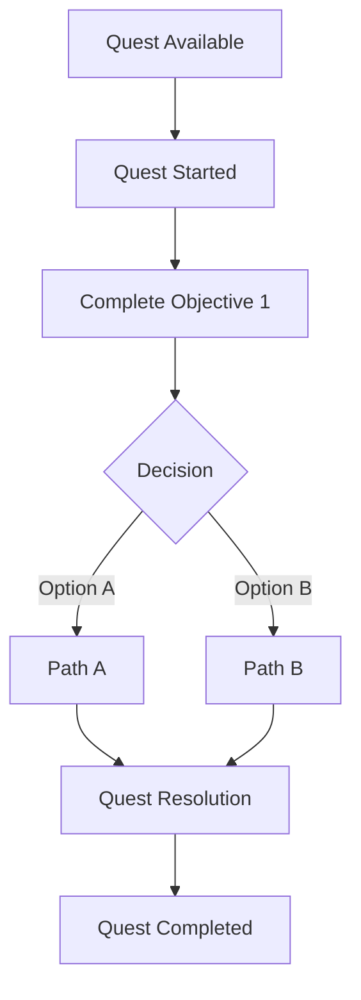

# Quest Template

> **Purpose:** This template guides AI agents and designers in creating project-specific quest specifications.
>
> A quest is a structured gameplay and narrative experience in which the player pursues an objective through a sequence of actions, decisions, challenges, and outcomes.
>
> This template is an authoring specification. AI agents must use approved project documentation and existing gameplay systems when generating a quest. They must not invent unsupported mechanics, characters, locations, narrative events, or rewards and present them as established project facts.
>
> Remove instructional text and sections that do not apply when generating the final project document.

---

## 1. Document Information

| Field | Value |
|---|---|
| Quest ID | `QUEST-XXX` |
| Quest Name | [Quest name] |
| Quest Type | [Main / Side / Optional / Tutorial / Repeatable / Other] |
| Project | [Project name] |
| Status | Draft |
| Priority | [Critical / High / Medium / Low] |
| Author | [Author or AI-assisted] |
| Quest Owner | [Responsible person] |
| Created Date | [YYYY-MM-DD] |
| Last Updated | [YYYY-MM-DD] |
| Related Quest IDs | [Quest IDs] |
| Related Documents | [Links] |

### 1.1 Quest Summary

[Provide a concise description of the quest, its purpose, and what the player will experience.]

### 1.2 Quest Classification

**Quest Category:**

- [ ] Main story quest
- [ ] Side quest
- [ ] Optional exploration quest
- [ ] Character quest
- [ ] Faction quest
- [ ] Tutorial quest
- [ ] Challenge quest
- [ ] Collection quest
- [ ] Investigation quest
- [ ] Repeatable quest
- [ ] Dynamic or procedural quest
- [ ] Other: [Specify]

**Quest Structure:**

- [ ] Linear
- [ ] Branching
- [ ] Open-ended
- [ ] Multi-stage
- [ ] Emergent
- [ ] Repeatable
- [ ] Other: [Specify]

### 1.3 Quest Importance

Explain why this quest exists and what it contributes to the overall game.

Consider:

- Narrative progression.
- Character development.
- Gameplay introduction or mastery.
- Worldbuilding.
- Player exploration.
- Progression and rewards.
- Player choice and consequences.

---

## 2. Design Intent

### 2.1 Quest Purpose

Explain the intended purpose of the quest.

### 2.2 Design Goals

| ID | Design Goal | Expected Player Experience |
|---|---|---|
| GOAL-01 | [Goal] | [Expected experience] |
| GOAL-02 | [Goal] | [Expected experience] |

### 2.3 Player Experience

Describe what the player should experience while completing the quest.

- Intended emotions: [Emotions]
- Intended challenge: [Challenge]
- Intended decisions: [Decisions]
- Intended discoveries: [Discoveries]
- Intended satisfaction: [Expected outcome]

### 2.4 Core Pillar Alignment

Explain how the quest supports the game's core pillars.

| Core Pillar | Quest Contribution | Design Implication |
|---|---|---|
| [Pillar] | [Contribution] | [Implication] |

### 2.5 Design Boundaries

Define what this quest should and should not attempt to accomplish.

**Must achieve:**
- [Requirement]

**Should achieve:**
- [Requirement]

**Must avoid:**
- [Constraint]

---

## 3. Narrative Context

### 3.1 Narrative Summary

Describe the story behind the quest.

Include:

- Relevant background.
- Current situation.
- Reason the quest exists.
- Narrative conflict.
- Expected narrative outcome.

### 3.2 Quest Premise

Describe the initial situation that introduces the quest to the player.

### 3.3 Narrative Motivation

Explain why the player would become involved.

Distinguish between:

- Character motivation.
- Player motivation.
- Gameplay motivation.
- World or story consequences.

### 3.4 Narrative Stakes

Explain what is at risk or what can change as a result of the quest.

### 3.5 Narrative Themes and Tone

| Element | Description |
|---|---|
| Primary Theme | [Theme] |
| Secondary Themes | [Themes] |
| Narrative Tone | [Tone] |
| Emotional Direction | [Direction] |
| Content Boundaries | [Constraints] |

### 3.6 Narrative Continuity

Identify established narrative facts that must be preserved.

| Fact / Rule | Source Document | Constraint |
|---|---|---|
| [Fact] | [Reference] | [How it affects the quest] |

### 3.7 Spoiler Classification

- **Public information:** [Information available early]
- **Progressive revelations:** [Information discovered during the quest]
- **Restricted information:** [Major revelations or outcomes]

---

## 4. Characters and Factions

### 4.1 Quest Characters

| Character ID | Name | Role | Quest Contribution |
|---|---|---|---|
| [CHAR-XXX] | [Name] | [Role] | [Contribution] |

### 4.2 Character Motivations

For each important character, explain:

- What the character wants.
- Why the character wants it.
- What prevents them from achieving it.
- How the quest affects their situation.
- What the player should understand about them.

### 4.3 Character Relationships

Describe relevant relationships between characters and how they influence the quest.

### 4.4 Factions and Organizations

| Faction ID | Name | Relationship to Quest | Relevant Interests |
|---|---|---|---|
| [FACTION-XXX] | [Name] | [Relationship] | [Interests] |

### 4.5 Character Consistency

Reference existing character specifications. Do not redefine established personalities, motivations, histories, or relationships within the quest document.

---

## 5. World and Location Context

### 5.1 Primary Location

| Property | Description |
|---|---|
| Location ID | [LOCATION-XXX] |
| Name | [Location name] |
| Type | [Location type] |
| Narrative Significance | [Significance] |
| Gameplay Significance | [Significance] |

### 5.2 Additional Locations

| Location ID | Name | Purpose in Quest |
|---|---|---|
| [LOCATION-XXX] | [Name] | [Purpose] |

### 5.3 Environmental Context

Describe the relevant environmental conditions.

Consider:

- Geography and layout.
- Important landmarks.
- Environmental hazards.
- Interactive objects.
- Relevant NPCs or enemies.
- Environmental storytelling.
- Navigation constraints.

Detailed level layouts and encounter specifications should remain in their respective documents.

### 5.4 World Rules and Constraints

Identify world rules that affect quest events, player actions, or outcomes.

---

## 6. Quest Prerequisites and Availability

### 6.1 Availability Conditions

Describe when and how the quest becomes available.

| Condition ID | Requirement | Required? |
|---|---|---|
| COND-01 | [Requirement] | [Yes / No] |
| COND-02 | [Requirement] | [Yes / No] |

### 6.2 Prerequisite Quests

| Quest ID | Quest Name | Requirement |
|---|---|---|
| [QUEST-XXX] | [Name] | [Completed / Started / Other] |

### 6.3 Other Prerequisites

Consider:

- Player progression.
- Character relationships.
- Faction reputation.
- Required items.
- Required abilities.
- World-state conditions.
- Location access.
- Previous decisions.

### 6.4 Quest Availability Rules

Define:

- Whether the quest is permanently available.
- Whether it can expire.
- Whether it can be missed.
- Whether it can be repeated.
- Whether it can be abandoned.
- Whether availability changes based on player decisions.

### 6.5 Quest Introduction

Describe how the player discovers the quest.

Examples:

- NPC interaction.
- Environmental discovery.
- Story event.
- Exploration.
- Item or document.
- Automatic progression trigger.

---

## 7. Quest Objectives

### 7.1 Primary Objective

Describe the main objective that defines quest completion.

### 7.2 Secondary Objectives

Describe optional objectives that provide additional value without being required for the main quest outcome.

### 7.3 Objective List

| Objective ID | Objective | Type | Completion Condition | Required? |
|---|---|---|---|---|
| OBJ-01 | [Objective] | [Primary / Secondary] | [Condition] | [Yes / No] |
| OBJ-02 | [Objective] | [Primary / Secondary] | [Condition] | [Yes / No] |

### 7.4 Objective Dependencies

Describe the required order or dependencies between objectives.

### 7.5 Objective Completion Rules

Specify:

- What counts as completion.
- Whether objectives can be completed in different orders.
- Whether objectives can be skipped.
- Whether progress persists after leaving the area.
- Whether objective completion can be reversed.
- How the player receives feedback.

### 7.6 Objective Failure Conditions

Identify conditions that prevent an objective from being completed.

---

## 8. Quest Flow and Structure

### 8.1 Quest Flow Overview

Provide a high-level explanation of the quest's progression.

### 8.2 Quest Flow Diagram

Represent the main quest flow using Mermaid when it improves clarity.

Example:

Replace the example with the actual quest structure. Do not include branches that have not been approved.

### 8.3 Quest Stages

| Stage ID | Stage Name | Description | Entry Condition | Exit Condition |
|---|---|---|---|---|
| STAGE-01 | [Name] | [Description] | [Condition] | [Condition] |
| STAGE-02 | [Name] | [Description] | [Condition] | [Condition] |

### 8.4 Stage Details

For each significant stage, document:

**Stage ID:** [STAGE-XXX]

- Purpose: [Purpose]
- Player objective: [Objective]
- Location: [Location]
- Required interactions: [Interactions]
- Challenges: [Challenges]
- Narrative information: [Information]
- Completion condition: [Condition]
- Next stage: [Stage or outcome]

### 8.5 Alternative Paths

Describe valid alternative paths through the quest.

### 8.6 Quest Interruptions

Explain what happens if the player:

- Leaves the quest location.
- Starts another quest.
- Dies or fails.
- Saves and reloads.
- Changes relevant world conditions.
- Loses access to a required item or character.

### 8.7 Quest Completion

Define the exact conditions under which the quest is considered complete.

---

## 9. Player Actions and Interactions

### 9.1 Required Player Actions

| Action | Purpose | Related Mechanic / System |
|---|---|---|
| [Action] | [Purpose] | [Reference] |

### 9.2 Interactive Elements

| Element ID | Element | Interaction | Expected Result |
|---|---|---|---|
| [ELEMENT-XXX] | [Element] | [Interaction] | [Result] |

### 9.3 NPC Interactions

Describe important NPC interactions and their gameplay purpose.

### 9.4 Objects and Environmental Interactions

Describe relevant objects, environmental interactions, and their consequences.

### 9.5 Required Mechanics

List the gameplay mechanics required to complete the quest.

| Mechanic / System | Required Usage | Existing Specification |
|---|---|---|
| [Mechanic] | [Usage] | [Reference] |

Do not redefine established gameplay systems. Reference their specifications.

### 9.6 Player Feedback

Describe how the game communicates:

- Available interactions.
- Objective progress.
- Successful actions.
- Failed actions.
- Important discoveries.
- Quest state changes.
- Consequences of decisions.

---

## 10. Challenges and Encounters

### 10.1 Quest Challenges

Describe the challenges the player must overcome.

| Challenge ID | Challenge | Type | Difficulty | Related Objective |
|---|---|---|---|---|
| [CHALLENGE-XXX] | [Description] | [Combat / Puzzle / Exploration / Social / Other] | [Level] | [OBJ-XXX] |

### 10.2 Encounter Specifications

If the quest contains combat or other structured encounters, describe their purpose and requirements.

Include:

- Encounter location.
- Intended player experience.
- Opponents or obstacles.
- Environmental factors.
- Victory conditions.
- Failure conditions.
- Relevant rewards or consequences.

Detailed encounter and level design should be documented separately when necessary.

### 10.3 Difficulty Expectations

Describe the intended difficulty and relevant player capabilities.

### 10.4 Failure and Recovery

Explain:

- What constitutes failure.
- Whether failure is temporary or permanent.
- Whether the player can retry.
- What progress is retained.
- Whether failure changes the narrative.
- Whether recovery requires additional actions.

---

## 11. Player Choices and Consequences

### 11.1 Choice Overview

Describe meaningful decisions the player can make during the quest.

| Choice ID | Decision | Available Options | Consequence |
|---|---|---|---|
| CHOICE-01 | [Decision] | [Options] | [Consequence] |

### 11.2 Choice Details

For each important choice:

**Choice ID:** [CHOICE-XXX]

- Context: [Situation]
- Available options: [Options]
- Required conditions: [Conditions]
- Immediate consequences: [Consequences]
- Delayed consequences: [Consequences]
- Reversibility: [Reversible / Irreversible]
- Narrative impact: [Impact]
- Gameplay impact: [Impact]

### 11.3 Branching Outcomes

Describe how decisions influence quest progression and resolution.

### 11.4 Persistent Consequences

Identify effects that persist beyond the quest.

Examples:

- Character relationships.
- Faction reputation.
- World state.
- Resource availability.
- Future quest availability.
- Character survival.
- Narrative information.

### 11.5 Choice Communication

Explain how the game communicates choices and their consequences without necessarily revealing every future outcome.

### 11.6 Choice Consistency

Ensure that choices respect established character motivations, world rules, and gameplay capabilities.

---

## 12. Quest Rewards and Progression

### 12.1 Primary Rewards

| Reward ID | Reward | Quantity / Value | Grant Condition |
|---|---|---|---|
| REWARD-01 | [Reward] | [Value] | [Condition] |

### 12.2 Optional Rewards

| Reward ID | Reward | Requirement | Purpose |
|---|---|---|---|
| REWARD-02 | [Reward] | [Requirement] | [Purpose] |

### 12.3 Reward Categories

Select applicable categories:

- [ ] Currency.
- [ ] Experience or progression.
- [ ] Equipment.
- [ ] Consumables.
- [ ] Crafting materials.
- [ ] Abilities or upgrades.
- [ ] Reputation.
- [ ] Narrative information.
- [ ] New locations or content.
- [ ] Character relationship changes.
- [ ] Other: [Specify]

### 12.4 Reward Distribution

Specify:

- When rewards are granted.
- Whether rewards depend on player choices.
- Whether optional objectives affect rewards.
- Whether rewards can be lost.
- Whether rewards are granted more than once.
- Whether rewards persist after reloading.

### 12.5 Progression Impact

Explain how the quest contributes to player progression and the broader game experience.

---

## 13. Quest State and Persistence

### 13.1 Quest States

Define the states supported by the quest.

| State | Description | Entry Condition |
|---|---|---|
| Locked | [Quest unavailable] | [Condition] |
| Available | [Quest can be started] | [Condition] |
| Active | [Quest in progress] | [Condition] |
| Completed | [Quest successfully completed] | [Condition] |
| Failed | [Quest failed] | [Condition] |
| Abandoned | [Quest abandoned, if supported] | [Condition] |

Use only states supported by the project's quest system.

### 13.2 State Transitions

Describe valid transitions and their conditions.

### 13.3 Persistence Requirements

Specify which information must survive saving and loading.

Consider:

- Quest state.
- Completed objectives.
- Current stage.
- Player choices.
- Character states.
- World changes.
- Rewards already granted.
- Failed or abandoned status.

### 13.4 Reload and Recovery Behavior

Describe the expected behavior when the player loads a save during an active quest.

### 13.5 Repeatability

If the quest can be repeated, define reset conditions and which outcomes or rewards can be repeated.

---

## 14. Quest Presentation and User Experience

### 14.1 Quest Discovery

Explain how the quest is presented to the player.

### 14.2 Quest Journal

Define the information displayed in the quest journal or equivalent interface.

### 14.3 Objective Tracking

Describe how objectives are communicated and updated.

### 14.4 Navigation and Guidance

Specify whether the quest uses:

- Map markers.
- Directional indicators.
- Environmental clues.
- NPC guidance.
- Quest journal hints.
- No explicit navigation assistance.

### 14.5 Dialogue and Narrative Presentation

Describe the intended use of dialogue, narration, documents, environmental storytelling, and other narrative delivery methods.

### 14.6 Accessibility and Clarity

Identify relevant accessibility and usability considerations.

Examples:

- Readability.
- Subtitle requirements.
- Objective clarity.
- Color-independent indicators.
- Audio alternatives for important information.
- Difficulty and assistance options.

Detailed UI specifications should remain in the relevant UI/UX documentation.

---

## 15. Technical and Content Dependencies

### 15.1 Required Systems

| System | Purpose | Specification Reference |
|---|---|---|
| [System] | [Purpose] | [Reference] |

### 15.2 Required Assets

| Asset | Type | Purpose | Status |
|---|---|---|---|
| [Asset] | [Character / Environment / Audio / UI / Other] | [Purpose] | [Status] |

### 15.3 Required Content

Identify required:

- Characters.
- Locations.
- Dialogue.
- Animations.
- Audio.
- Interactive objects.
- Enemies or encounters.
- UI elements.
- Narrative documents.

### 15.4 Technical Constraints

Describe implementation constraints that affect the quest.

### 15.5 Dependencies and Risks

| ID | Dependency / Risk | Impact | Mitigation |
|---|---|---|---|
| DEP-01 | [Description] | [Impact] | [Mitigation] |

---

## 16. Edge Cases and Exploit Prevention

Identify unusual situations that could break the quest or produce unintended outcomes.

Consider:

- Player leaves the quest area.
- Required NPC becomes unavailable.
- Required object is destroyed or moved.
- Player obtains an objective item early.
- Objectives are completed in an unexpected order.
- Quest is interrupted by another event.
- Player dies during an encounter.
- Player repeats an interaction.
- Rewards are granted multiple times.
- Save data is loaded from an earlier quest state.
- World state changes while the quest is active.
- A branch becomes unavailable.
- A prerequisite is no longer satisfied.

| Edge Case | Expected Behavior | Validation Required |
|---|---|---|
| [Case] | [Expected behavior] | [Yes / No] |

---

## 17. Testing and Validation

### 17.1 Functional Validation

Verify:

- Quest availability and activation.
- Objective progression.
- Stage transitions.
- Interaction requirements.
- Completion conditions.
- Failure and recovery.
- Reward distribution.
- Quest state persistence.

### 17.2 Narrative Validation

Verify:

- Narrative consistency.
- Character motivation.
- Dialogue continuity.
- Worldbuilding consistency.
- Choice and consequence consistency.
- Appropriate narrative pacing.
- Alignment with approved themes and tone.

### 17.3 Player Experience Validation

Evaluate:

- Objective clarity.
- Player understanding.
- Navigation and discovery.
- Challenge and pacing.
- Meaningfulness of decisions.
- Reward satisfaction.
- Narrative engagement.

### 17.4 Test Cases

| Test ID | Scenario | Expected Result | Priority |
|---|---|---|---|
| TC-XXX | [Scenario] | [Expected result] | [Critical / High / Medium / Low] |

### 17.5 Acceptance Criteria

The quest is considered ready for acceptance when:

- [ ] All required objectives can be completed.
- [ ] All required stages and transitions work correctly.
- [ ] Quest availability follows the specified conditions.
- [ ] Failure and recovery behave as designed.
- [ ] Rewards are granted correctly.
- [ ] Save and load preserve the expected quest state.
- [ ] Player choices produce the specified consequences.
- [ ] No known critical quest-blocking defects remain.
- [ ] Narrative content is consistent with approved project documents.
- [ ] Required assets and interactions are integrated.
- [ ] Relevant documentation is complete.
- [ ] The project owner has reviewed the quest.

---

## 18. Open Questions and Unresolved Decisions

Record information that still requires clarification.

| ID | Question / Decision | Impact | Current Understanding | Next Action |
|---|---|---|---|---|
| OPEN-01 | [Question] | [Impact] | [Known information] | [Action] |

Distinguish between:

- Confirmed decisions.
- Reasonable derived details.
- Proposed ideas.
- Unresolved design questions.

Do not invent answers to make the quest specification appear complete.

---

## 19. AI-Assisted Quest Generation Guidelines

AI agents generating or modifying quests MUST:

1. Read the approved Game Vision, GDD, Core Pillars, Narrative Overview, and relevant gameplay specifications before designing the quest.
2. Inspect existing quest, character, location, faction, and system documents.
3. Reuse established characters, locations, mechanics, and terminology where appropriate.
4. Preserve narrative canon and established world rules.
5. Respect the project's core gameplay loop and design pillars.
6. Avoid introducing unsupported gameplay systems or mechanics.
7. Distinguish confirmed information from derived details and proposals.
8. Ensure objectives are understandable and have verifiable completion conditions.
9. Ensure quest stages and state transitions are logically consistent.
10. Consider failure, interruption, save/load, and edge cases.
11. Avoid duplicate quests or redundant objectives.
12. Avoid creating rewards that contradict the project's economy or progression design.
13. Reference existing specifications instead of duplicating their full content.
14. Identify dependencies and unresolved decisions.
15. Never approve major narrative or gameplay changes independently.

### 19.1 Quest Generation Quality Checks

Before presenting a generated quest, verify:

- Does it support the game's intended player experience?
- Does it have a clear purpose?
- Is the quest motivation understandable?
- Are objectives actionable and testable?
- Are the stages and transitions coherent?
- Are player choices meaningful when included?
- Are consequences consistent with the world?
- Are rewards appropriate?
- Can the quest be completed without unintended blockers?
- Does the quest respect existing project scope?
- Are all important assumptions identified?

### 19.2 Project Owner Review

The project owner must review and approve significant decisions involving:

- Main story progression.
- Major character outcomes.
- Important world-state changes.
- Permanent player choices.
- New gameplay mechanics.
- Significant quest rewards.
- Changes to established narrative canon.

---

## 20. Approval and Change History

### 20.1 Review Status

| Review Area | Reviewer | Status | Date |
|---|---|---|---|
| Narrative Review | [Name] | [Pending / Approved] | [Date] |
| Gameplay Review | [Name] | [Pending / Approved] | [Date] |
| Technical Review | [Name] | [Pending / Approved] | [Date] |
| Project Owner Approval | [Name] | [Pending / Approved] | [Date] |

### 20.2 Change History

| Version | Date | Author | Description |
|---|---|---|---|
| 1.0 | [YYYY-MM-DD] | [Author] | Initial quest specification |

### 20.3 Related Documents

- Game Design Document: `game_project/docs/game_design/game_design_document.md`
- Game Vision: `game_project/docs/game_design/game_vision.md`
- Core Pillars: `game_project/docs/game_design/core_pillars.md`
- Narrative Overview: `game_project/docs/game_design/narrative/narrative_overview.md`
- Narrative Design Guidelines: `docs/01_game_design_guidelines/NARRATIVE_DESIGN_GUIDELINES.md`
- Quest Design Guidelines: [Add the actual project or studio reference if one exists]
- Character Specifications: `game_project/docs/game_design/characters/`
- Level Design Specifications: `game_project/docs/game_design/levels/`
- Gameplay System Specifications: `game_project/docs/game_design/systems/`
- Acceptance Criteria Guidelines: `docs/05_qa_standards/ACCEPTANCE_CRITERIA_GUIDELINES.md`

Only retain references that exist in the applicable repository.

---

**End of Quest Specification**
