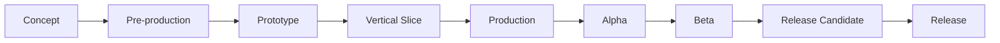

# Roadmap Template

> **Purpose:** This template defines the structure for a project-specific development roadmap.
>
> A roadmap communicates the project's intended direction, major development priorities, planned outcomes, and approximate sequencing over time.
>
> A roadmap is a planning reference, not a fixed delivery contract. Its contents should evolve as the project progresses, new information becomes available, and priorities change.
>
> Remove instructional text and sections that do not apply when generating the final project document.

---

## 1. Document Information

| Field | Value |
|---|---|
| Document Title | [Project Name] Development Roadmap |
| Project | [Project name] |
| Document ID | ROADMAP-001 |
| Status | Draft |
| Roadmap Owner | [Project owner] |
| Created Date | [YYYY-MM-DD] |
| Last Updated | [YYYY-MM-DD] |
| Planning Horizon | [Time period or development phases] |
| Review Frequency | [e.g. Monthly / At milestone completion] |
| Related Documents | [Links] |

### 1.1 Roadmap Summary

[Provide a concise overview of the project's development direction, current stage, major priorities, and intended outcomes.]

### 1.2 Roadmap Purpose

Explain what this roadmap is intended to communicate and support.

Examples:

- Communicate the project's development direction.
- Identify major development priorities.
- Organize work into meaningful milestones.
- Show dependencies between major outcomes.
- Support production planning and prioritization.
- Communicate progress and changes to stakeholders.

### 1.3 Roadmap Audience

Identify who uses this roadmap.

- Project owner.
- Developers and collaborators.
- AI agents involved in planning and implementation.
- Other stakeholders, when applicable.

---

## 2. Project Direction

### 2.1 Project Vision

Summarize the approved project vision.

Reference the project's Game Vision document rather than duplicating its full contents.

### 2.2 Project Objectives

| ID | Objective | Expected Outcome | Priority |
|---|---|---|---|
| OBJ-01 | [Objective] | [Outcome] | [Critical / High / Medium / Low] |
| OBJ-02 | [Objective] | [Outcome] | [Critical / High / Medium / Low] |

### 2.3 Strategic Priorities

Identify the most important areas of development.

Examples:

- Core gameplay implementation.
- Gameplay system development.
- Technical foundation.
- Narrative and content production.
- Art and audio production.
- Quality and performance.
- Platform and release preparation.

| Priority | Area | Description | Rationale |
|---|---|---|---|
| 1 | [Area] | [Description] | [Reason] |
| 2 | [Area] | [Description] | [Reason] |

### 2.4 Project Constraints

Document constraints that influence roadmap planning.

Consider:

- Available development capacity.
- Budget and resources.
- Technical limitations.
- Platform requirements.
- Content production capacity.
- External dependencies.
- Project scope.
- Known risks.

---

## 3. Current Project Status

### 3.1 Current Lifecycle Stage

| Field | Value |
|---|---|
| Current Stage | [Initiation / Concept / Pre-production / Prototyping / Production / Alpha / Beta / Release Candidate / Release / Post-release] |
| Stage Start Date | [YYYY-MM-DD] |
| Current Milestone | [Milestone ID and name] |
| Overall Status | [On Track / At Risk / Blocked / Paused] |
| Last Status Review | [YYYY-MM-DD] |

### 3.2 Current Development Summary

Describe the current state of the project.

Include:

- Completed work.
- Work currently in progress.
- Major achievements.
- Outstanding work.
- Important decisions already made.

### 3.3 Completed Milestones

| Milestone ID | Milestone Name | Completion Date | Outcome |
|---|---|---|---|
| MILESTONE-001 | [Name] | [YYYY-MM-DD] | [Summary] |

### 3.4 Current Priorities

| Priority | Work Area | Current Focus | Expected Outcome |
|---|---|---|---|
| 1 | [Area] | [Focus] | [Outcome] |
| 2 | [Area] | [Focus] | [Outcome] |

---

## 4. Roadmap Planning Principles

The roadmap must follow these principles:

1. **Outcome-oriented:** Organize plans around meaningful results rather than isolated activities.
2. **Aligned with project vision:** Priorities must support approved project objectives and design pillars.
3. **Realistic:** Account for actual development capacity, uncertainty, and dependencies.
4. **Incremental:** Prefer achievable development stages over excessively large plans.
5. **Flexible:** Allow priorities and sequencing to change when justified.
6. **Transparent:** Clearly distinguish confirmed commitments from tentative plans.
7. **Risk-aware:** Identify important risks and dependencies before they affect delivery.
8. **Quality-focused:** Include validation, integration, and performance work throughout development.
9. **Proportional:** Keep roadmap detail appropriate to the project's current stage and size.

---

## 5. Roadmap Overview

### 5.1 Planning Horizon

Define the period covered by the roadmap.

| Field | Description |
|---|---|
| Start | [Start date or development stage] |
| End | [End date or target stage] |
| Planning Unit | [Milestones / Phases / Quarters / Other] |
| Level of Detail | [High-level / Medium / Detailed] |

Long-term plans should generally use broader outcomes and less precise estimates than near-term plans.

### 5.2 Roadmap Timeline

Provide a high-level view of planned development phases and milestones.

| ID | Phase / Milestone | Planned Start | Planned End | Priority | Confidence | Status |
|---|---|---|---|---|---|---|
| MILESTONE-001 | [Name] | [Date] | [Date] | [Priority] | [High / Medium / Low] | [Status] |
| MILESTONE-002 | [Name] | [Date] | [Date] | [Priority] | [High / Medium / Low] | [Status] |
| MILESTONE-003 | [Name] | [Date] | [Date] | [Priority] | [High / Medium / Low] | [Status] |

Use approximate dates or development stages when exact scheduling is not justified.

### 5.3 Roadmap Visualization

Use a Mermaid diagram when it improves understanding of sequencing and dependencies.

Example:

Replace this example with the actual project roadmap. Do not imply that every project must follow an identical sequence or that all stages have fixed dates.

---

## 6. Development Phases

Describe the planned phases of development.

For each phase, define its objective, expected outcomes, major work areas, dependencies, and exit conditions.

### 6.1 Phase [Number]: [Phase Name]

| Field | Value |
|---|---|
| Phase ID | PHASE-XXX |
| Name | [Phase name] |
| Status | [Planned / In Progress / Completed / Paused] |
| Planned Start | [YYYY-MM-DD] |
| Planned End | [YYYY-MM-DD] |
| Confidence | [High / Medium / Low] |

**Objective:**

[Describe what this phase intends to achieve.]

**Expected Outcomes:**

- [Outcome]
- [Outcome]

**Major Work Areas:**

| Work Area | Description | Expected Result |
|---|---|---|
| [Area] | [Description] | [Result] |

**Dependencies:**

- [Dependency]

**Risks:**

- [Risk]

**Exit Criteria:**

- [Condition]
- [Condition]

**Related Milestones:**

- [Milestone ID]

Repeat this section for each significant development phase.

---

## 7. Milestone Roadmap

List the milestones that represent meaningful development outcomes.

Each milestone should have its own project-specific milestone record using `milestone_template.md`.

| Milestone ID | Name | Objective | Target Date | Status | Priority |
|---|---|---|---|---|---|
| MILESTONE-001 | [Name] | [Objective] | [Date] | [Status] | [Priority] |
| MILESTONE-002 | [Name] | [Objective] | [Date] | [Status] | [Priority] |

### 7.1 Milestone Details

For each major milestone, provide a summary.

**Milestone ID:** [MILESTONE-XXX]

- **Name:** [Name]
- **Objective:** [Objective]
- **Expected Outcome:** [Outcome]
- **Scope Summary:** [Major included work]
- **Dependencies:** [Dependencies]
- **Target Completion:** [Date or development stage]
- **Success Criteria:** [Measurable conditions]
- **Confidence:** [High / Medium / Low]
- **Milestone Record:** [Link to detailed milestone document]

### 7.2 Milestone Dependencies

Identify dependencies that affect milestone sequencing.

| Milestone | Depends On | Dependency Type | Impact |
|---|---|---|---|
| MILESTONE-002 | MILESTONE-001 | [Technical / Content / Production / Other] | [Impact] |

### 7.3 Milestone Completion and Changes

Describe how completed, delayed, cancelled, or restructured milestones are reflected in the roadmap.

Preserve historical milestone records. Do not silently rewrite completed outcomes to match later plans.

---

## 8. Feature and System Roadmap

Identify the major gameplay features and technical systems planned for development.

### 8.1 Feature Overview

| Feature ID | Feature / System | Description | Planned Phase | Priority | Status |
|---|---|---|---|---|---|
| FEATURE-001 | [Name] | [Description] | [Phase] | [Priority] | [Status] |
| FEATURE-002 | [Name] | [Description] | [Phase] | [Priority] | [Status] |

### 8.2 Feature Dependencies

Describe important relationships between features and systems.

| Feature | Dependency | Reason | Required Before |
|---|---|---|---|
| [Feature] | [Dependency] | [Reason] | [Milestone / Phase] |

### 8.3 Feature Prioritization

Explain why features are prioritized in their planned order.

Consider:

- Contribution to the core gameplay loop.
- Alignment with design pillars.
- Technical prerequisites.
- Player experience.
- Risk reduction.
- Development effort.
- Content dependencies.

### 8.4 Deferred Features

List features intentionally postponed.

| Feature | Reason for Deferral | Reconsideration Condition |
|---|---|---|
| [Feature] | [Reason] | [Condition] |

Deferred features are not automatically committed to future development.

---

## 9. Content and Production Roadmap

Summarize major content production plans.

### 9.1 Narrative and World Content

| Content Area | Planned Work | Expected Outcome | Target Phase |
|---|---|---|---|
| Characters | [Work] | [Outcome] | [Phase] |
| Locations | [Work] | [Outcome] | [Phase] |
| Quests | [Work] | [Outcome] | [Phase] |
| Story | [Work] | [Outcome] | [Phase] |

### 9.2 Art Production

| Content Area | Planned Work | Expected Outcome | Target Phase |
|---|---|---|---|
| Characters | [Work] | [Outcome] | [Phase] |
| Environments | [Work] | [Outcome] | [Phase] |
| Props | [Work] | [Outcome] | [Phase] |
| Animation | [Work] | [Outcome] | [Phase] |
| UI | [Work] | [Outcome] | [Phase] |
| Visual Effects | [Work] | [Outcome] | [Phase] |

### 9.3 Audio Production

| Content Area | Planned Work | Expected Outcome | Target Phase |
|---|---|---|---|
| Music | [Work] | [Outcome] | [Phase] |
| Sound Effects | [Work] | [Outcome] | [Phase] |
| Ambient Audio | [Work] | [Outcome] | [Phase] |
| Dialogue / Voice | [Work] | [Outcome] | [Phase] |

### 9.4 Content Dependencies

Identify content that depends on gameplay systems, technical implementation, narrative decisions, or other assets.

Avoid duplicating detailed asset production schedules in the roadmap. Reference the appropriate production records.

---

## 10. Technical Roadmap

Summarize major technical development priorities.

### 10.1 Technical Work Areas

| Area | Planned Work | Expected Outcome | Target Phase |
|---|---|---|---|
| Architecture | [Work] | [Outcome] | [Phase] |
| Gameplay Infrastructure | [Work] | [Outcome] | [Phase] |
| Data and Persistence | [Work] | [Outcome] | [Phase] |
| UI Infrastructure | [Work] | [Outcome] | [Phase] |
| Tools and Automation | [Work] | [Outcome] | [Phase] |
| Performance | [Work] | [Outcome] | [Phase] |
| Build and Deployment | [Work] | [Outcome] | [Phase] |

### 10.2 Technical Dependencies

Identify foundational systems that must exist before dependent work can proceed.

### 10.3 Technical Debt and Improvements

| Item | Reason | Priority | Planned Phase |
|---|---|---|---|
| [Technical debt item] | [Reason] | [Priority] | [Phase] |

### 10.4 Technical Risks

Identify technical uncertainties that could affect the roadmap.

Reference detailed technical decisions and risk records when available.

---

## 11. Quality and Validation Roadmap

Quality assurance and validation must be planned throughout development rather than postponed until release.

### 11.1 Quality Priorities

| Quality Area | Planned Activities | Expected Outcome | Target Phase |
|---|---|---|---|
| Functional Testing | [Activities] | [Outcome] | [Phase] |
| Gameplay Validation | [Activities] | [Outcome] | [Phase] |
| Playtesting | [Activities] | [Outcome] | [Phase] |
| Performance Testing | [Activities] | [Outcome] | [Phase] |
| Compatibility Testing | [Activities] | [Outcome] | [Phase] |
| Regression Testing | [Activities] | [Outcome] | [Phase] |

### 11.2 Quality Gates

Identify important validation checkpoints.

| Gate | Required Conditions | Target Milestone |
|---|---|---|
| Prototype Validation | [Conditions] | [Milestone] |
| Vertical Slice Validation | [Conditions] | [Milestone] |
| Alpha Validation | [Conditions] | [Milestone] |
| Beta Validation | [Conditions] | [Milestone] |
| Release Readiness | [Conditions] | [Milestone] |

### 11.3 Quality Risks

Identify quality concerns that could affect planned outcomes.

---

## 12. Dependencies and Critical Path

### 12.1 Major Dependencies

Identify external and internal dependencies that affect the roadmap.

| Dependency ID | Dependency | Type | Affected Work | Status |
|---|---|---|---|---|
| DEP-001 | [Dependency] | [Internal / External] | [Affected work] | [Status] |

### 12.2 Critical Path

Describe the sequence of work that most directly determines the timing of major project outcomes.

Do not label work as critical path without a clear dependency relationship.

### 12.3 Dependency Management

Explain how dependencies will be monitored, resolved, and updated.

---

## 13. Risks and Assumptions

### 13.1 Major Risks

Summarize risks that could significantly affect the roadmap.

| Risk ID | Risk | Likelihood | Impact | Response |
|---|---|---|---|---|
| RISK-001 | [Risk] | [1–5] | [1–5] | [Mitigation / Avoidance / Acceptance] |

Reference the project risk register for full risk details.

### 13.2 Planning Assumptions

| Assumption ID | Assumption | Impact if Incorrect | Validation Method |
|---|---|---|---|
| ASSUMPTION-001 | [Assumption] | [Impact] | [Method] |

### 13.3 Uncertainties

Identify areas where insufficient information prevents reliable planning.

### 13.4 Risk-Based Adjustments

Explain how significant risks or failed assumptions may change planned milestones, priorities, or scope.

---

## 14. Scope and Prioritization

### 14.1 Planned Scope

Summarize the development scope currently represented by the roadmap.

### 14.2 Excluded Scope

Identify features, systems, or content explicitly outside the current plan.

| Item | Reason for Exclusion | Reconsideration Condition |
|---|---|---|
| [Item] | [Reason] | [Condition] |

### 14.3 Priority Definitions

Use consistent priority definitions:

| Priority | Meaning |
|---|---|
| Critical | Essential to project viability or a required milestone outcome |
| High | Important to major project objectives |
| Medium | Valuable but not immediately necessary |
| Low | Optional or suitable for later consideration |

### 14.4 Scope Change Rules

Describe how significant changes to scope are evaluated.

Consider:

- Alignment with project vision.
- Impact on milestones.
- Development capacity.
- Dependencies.
- Risks.
- Quality implications.
- Effect on release objectives.

The project owner is responsible for approving significant roadmap scope changes.

---

## 15. Progress Tracking and Reporting

### 15.1 Roadmap Status Definitions

| Status | Meaning |
|---|---|
| Planned | Accepted as part of the current roadmap but not started |
| Ready | Prerequisites are satisfied and work can begin |
| In Progress | Work has started |
| At Risk | Expected outcome or target may not be achieved |
| Blocked | Work cannot proceed due to an unresolved blocker |
| Completed | Expected outcome has been achieved and accepted |
| Deferred | Work has been postponed |
| Cancelled | Work has been removed from the active roadmap |

### 15.2 Progress Summary

| Milestone | Status | Progress Summary | Main Concern |
|---|---|---|---|
| [Milestone] | [Status] | [Summary] | [Concern] |

Progress percentages should be used only when they represent meaningful, measurable progress. Avoid estimating completion based solely on the number of tasks closed.

### 15.3 Status Reporting

A roadmap status update should summarize:

- Completed outcomes.
- Current development focus.
- Upcoming milestones.
- Changes to priorities or sequencing.
- New risks and blockers.
- Decisions required from the project owner.

### 15.4 Review Frequency

Review the roadmap:

- At meaningful milestone completion.
- When major scope or priority changes occur.
- When significant risks materialize.
- When important technical or design assumptions change.
- At the project's established planning review interval.

---

## 16. Roadmap Change Management

### 16.1 Change Principles

Roadmap changes should be intentional, documented, and based on relevant evidence.

### 16.2 Change Triggers

Examples include:

- New design discoveries.
- Failed prototypes or validation.
- Changes in development capacity.
- Technical constraints.
- New dependencies.
- Major defects or quality concerns.
- Changes in project vision or scope.
- Changes in platform or release requirements.

### 16.3 Change Evaluation

Before changing the roadmap, evaluate:

1. Why the change is necessary.
2. Which objectives are affected.
3. Which milestones or features are affected.
4. Whether dependencies must be reordered.
5. Whether risks increase or decrease.
6. Whether the target scope or release plan changes.
7. Whether project documentation requires updates.

### 16.4 Change History

| Date | Change | Reason | Affected Areas | Approved By |
|---|---|---|---|---|
| [YYYY-MM-DD] | [Description] | [Reason] | [Areas] | [Owner] |

Preserve historical records of completed milestones and previous roadmap decisions.

---

## 17. AI-Assisted Roadmap Management

AI agents may help create, analyze, update, and maintain the roadmap.

They MUST:

1. Read the approved Game Vision, GDD, project lifecycle, milestone guidelines, and relevant production documentation before proposing major roadmap changes.
2. Inspect the existing roadmap and milestone records before adding or modifying entries.
3. Use the backlog and milestone records as sources for detailed work status.
4. Distinguish confirmed plans from tentative proposals.
5. Avoid inventing dates, estimates, capacity, completed work, or approvals.
6. Identify assumptions and uncertainty explicitly.
7. Consider dependencies, risks, technical constraints, and quality requirements.
8. Avoid treating every backlog item as a roadmap milestone.
9. Avoid creating duplicate milestones or conflicting plans.
10. Preserve historical records of completed or cancelled work.
11. Recommend scope or sequencing changes with clear justification.
12. Never approve significant roadmap changes independently.
13. Update related documentation only when authorized and necessary.
14. Report inconsistencies between the roadmap, backlog, milestones, and actual project state.

### 17.1 AI Roadmap Review Checklist

Before proposing or updating the roadmap, verify:

- [ ] The roadmap reflects the approved project vision.
- [ ] Priorities support the project's design pillars.
- [ ] Current status is supported by project records.
- [ ] Milestones describe meaningful outcomes.
- [ ] Major dependencies are identified.
- [ ] Risks and assumptions are documented.
- [ ] Quality and validation work are included.
- [ ] Planned scope is realistic.
- [ ] Tentative plans are not presented as commitments.
- [ ] Historical information is preserved.
- [ ] Related project documents are consistent.

### 17.2 AI Change Proposal

When proposing a significant roadmap change, provide:

| Field | Description |
|---|---|
| Proposed Change | [What should change] |
| Reason | [Why the change is needed] |
| Evidence | [Supporting information] |
| Affected Milestones | [Milestone IDs] |
| Affected Features | [Feature IDs] |
| Risks | [Potential risks] |
| Alternatives | [Other possible approaches] |
| Recommendation | [Suggested action] |
| Approval Required | Yes |

---

## 18. Roadmap Review and Approval

### 18.1 Review Checklist

- [ ] The roadmap has a clear purpose and planning horizon.
- [ ] Development priorities align with project objectives.
- [ ] Current project status is accurate.
- [ ] Major phases and milestones are identified.
- [ ] Feature and system dependencies are documented.
- [ ] Content and technical work are represented.
- [ ] Quality and validation activities are included.
- [ ] Risks and assumptions are visible.
- [ ] Scope boundaries are clear.
- [ ] Dates and confidence levels reflect actual planning certainty.
- [ ] Related documents are consistent.
- [ ] The project owner has reviewed the roadmap.

### 18.2 Approval

| Role | Name | Status | Date |
|---|---|---|---|
| Roadmap Author | [Name] | [Pending / Reviewed] | [Date] |
| Project Owner | [Name] | [Pending / Approved] | [Date] |

The roadmap remains in Draft or In Review status until the project owner approves it.

Approval does not make every future roadmap item an unconditional commitment. Plans remain subject to documented review and change management.

---

## 19. Related Documents

Use the following documents when applicable:

- Game Vision: `game_project/docs/game_design/game_vision.md`
- Game Design Document: `game_project/docs/game_design/game_design_document.md`
- Core Pillars: `game_project/docs/game_design/core_pillars.md`
- Project Lifecycle: `game_project/docs/production/project_lifecycle.md`
- Milestone Guidelines: `docs/04_production_standards/milestone_guidelines.md`
- Milestone Template: `docs/06_templates/milestone_template.md`
- Backlog Management: `docs/04_production_standards/backlog_management.md`
- Sprint Workflow: `docs/04_production_standards/sprint_workflow.md`
- Risk Management: `docs/04_production_standards/risk_management.md`
- Definition of Done: `docs/00_studio_standards/definition_of_done.md`
- QA Strategy: `docs/05_qa_standards/qa_strategy.md`
- Postmortem Guidelines: `docs/04_production_standards/postmortem_guidelines.md`

Only retain references to documents that exist in the applicable repository.

---

**End of Roadmap Template**
