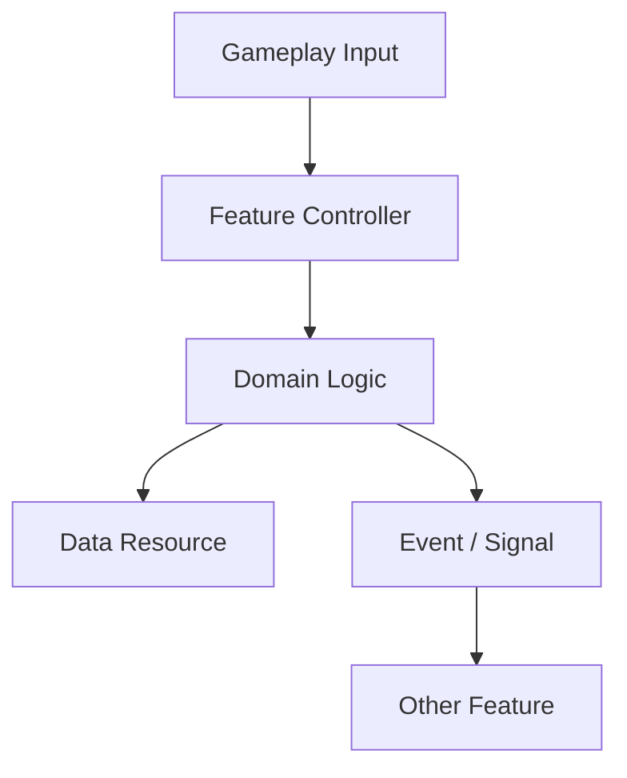
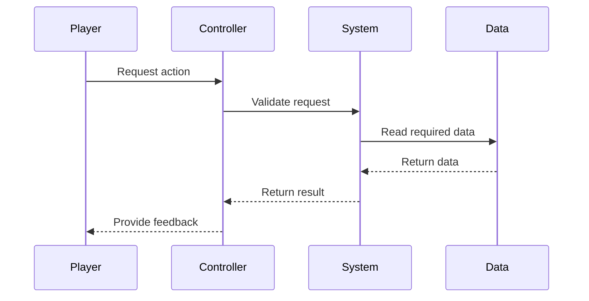

# Technical Design Template

> **Purpose:** This template defines the structure for project-specific technical design documents.
>
> A technical design document describes how a feature, system, or engineering change will be implemented. It translates requirements and approved design decisions into a technical solution that can be implemented, tested, reviewed, and maintained.
>
> This template is intended for significant technical work. Small, straightforward changes do not require a separate technical design document unless their complexity, risk, or architectural impact justifies one.
>
> Remove instructional text and sections that do not apply when generating the final document.

---

## 1. Document Information

| Field | Value |
|---|---|
| Document ID | TECH-XXX |
| Title | [Technical design title] |
| Project | [Project name] |
| Related Feature / System | [Feature or system name] |
| Status | Draft |
| Author | [Author or AI-assisted] |
| Technical Owner | [Responsible person] |
| Created Date | [YYYY-MM-DD] |
| Last Updated | [YYYY-MM-DD] |
| Related ADRs | [ADR IDs] |
| Related Documents | [Links] |

### 1.1 Executive Summary

[Provide a concise explanation of the technical problem, proposed solution, and expected result.]

### 1.2 Design Status

Use one of the following statuses:

- **Draft:** Initial design, subject to revision.
- **In Review:** Submitted for technical and project owner review.
- **Approved:** Reviewed and approved by the project owner.
- **Implemented:** The approved design has been implemented.
- **Superseded:** Replaced by a newer technical design.
- **Deprecated:** No longer applicable.

---

## 2. Problem Statement and Context

### 2.1 Problem Description

Describe the technical problem or implementation requirement.

Explain:

- What needs to be implemented or changed.
- Why the work is necessary.
- What currently prevents the desired outcome.
- Which existing systems or components are affected.

### 2.2 Background

Provide relevant technical and project context.

Include:

- Existing architecture.
- Current implementation.
- Relevant engine or framework behavior.
- Previous technical decisions.
- Known limitations.
- Related features or systems.

### 2.3 Motivation

Explain why the proposed work is necessary.

Consider:

- New gameplay requirements.
- Maintainability improvements.
- Performance requirements.
- Reliability issues.
- Technical debt.
- Scalability.
- Integration requirements.
- Security or data integrity.

### 2.4 Current Behavior

Describe how the relevant system currently works, if applicable.

### 2.5 Desired Behavior

Describe the expected technical outcome after implementation.

---

## 3. Goals and Non-Goals

### 3.1 Technical Goals

| ID | Goal | Expected Result |
|---|---|---|
| GOAL-01 | [Technical goal] | [Expected result] |
| GOAL-02 | [Technical goal] | [Expected result] |

### 3.2 Non-Goals

Explicitly identify what this design does not intend to address.

| ID | Non-Goal | Reason |
|---|---|---|
| NON-GOAL-01 | [Excluded work] | [Reason] |

Non-goals prevent the implementation from expanding beyond its intended scope.

### 3.3 Success Criteria

Define measurable or verifiable conditions that indicate the design has achieved its goals.

---

## 4. Requirements

### 4.1 Functional Requirements

Describe what the implementation must do.

| Requirement ID | Requirement | Priority | Verification Method |
|---|---|---|---|
| FR-01 | [Requirement] | [Critical / High / Medium / Low] | [Test / Inspection / Other] |
| FR-02 | [Requirement] | [Priority] | [Verification] |

### 4.2 Non-Functional Requirements

Identify relevant quality attributes.

| Requirement ID | Quality Attribute | Requirement | Verification Method |
|---|---|---|---|
| NFR-01 | Performance | [Requirement] | [Measurement] |
| NFR-02 | Reliability | [Requirement] | [Verification] |
| NFR-03 | Maintainability | [Requirement] | [Review] |

Consider:

- Performance.
- Reliability.
- Maintainability.
- Modularity.
- Testability.
- Compatibility.
- Accessibility.
- Security.
- Data integrity.
- Resource usage.

Only include requirements relevant to the design.

### 4.3 Constraints

Document technical and project constraints.

Examples:

- Godot version.
- GDScript requirements.
- Existing architecture.
- Target platforms.
- Available plugins or dependencies.
- Memory or performance budgets.
- Feature boundaries.
- Backward compatibility.
- Project structure standards.

### 4.4 Assumptions

| ID | Assumption | Impact if Incorrect | Validation |
|---|---|---|---|
| ASSUMPTION-01 | [Assumption] | [Impact] | [Validation method] |

Distinguish verified requirements from assumptions that still need confirmation.

---

## 5. Proposed Technical Solution

### 5.1 Solution Overview

Describe the proposed implementation at a high level.

Explain:

- The main technical approach.
- Major components.
- Responsibilities.
- Data flow.
- Integration points.
- Important implementation decisions.

### 5.2 Design Rationale

Explain why this approach is appropriate.

Consider:

- Simplicity.
- Compatibility with existing architecture.
- Maintainability.
- Performance.
- Testability.
- Development effort.
- Risks.
- Future extension requirements.

### 5.3 Alternatives Considered

Document meaningful alternatives.

| Option | Description | Advantages | Disadvantages | Reason for Selection / Rejection |
|---|---|---|---|---|
| Option A | [Description] | [Advantages] | [Disadvantages] | [Reason] |
| Option B | [Description] | [Advantages] | [Disadvantages] | [Reason] |

Not every minor implementation choice requires an alternatives analysis. Focus on decisions that materially affect the solution.

### 5.4 High-Level Architecture

Describe how the proposed solution fits into the existing project architecture.

Include relevant:

- Features.
- Shared components.
- Infrastructure.
- Autoloads.
- Scenes.
- Scripts.
- Resources.
- External dependencies.

### 5.5 Architecture Diagram

Use Mermaid when a diagram improves understanding.

Example:



Replace the example with the actual architecture.

---

## 6. Component and Module Design

### 6.1 Component Overview

List the main components involved in the implementation.

| Component | Responsibility | Type | Location |
|---|---|---|---|
| [Component] | [Responsibility] | [Scene / Script / Resource / Other] | [Repository path] |

### 6.2 Component Responsibilities

For each significant component, document:

**Component:** [Component name]

- Purpose: [Purpose]
- Responsibilities: [Responsibilities]
- Inputs: [Inputs]
- Outputs: [Outputs]
- Dependencies: [Dependencies]
- Owned data: [Data]
- Lifecycle: [Lifecycle]
- Failure behavior: [Expected behavior]

### 6.3 Component Interactions

Describe how components communicate.

Identify:

- Direct method calls.
- Signals and events.
- Shared resources.
- Data exchange.
- Ownership relationships.
- Initialization dependencies.

### 6.4 Interfaces and Contracts

Document important public interfaces.

| Interface | Provider | Consumer | Contract |
|---|---|---|---|
| [Interface] | [Component] | [Component] | [Expected behavior] |

Specify relevant:

- Method signatures.
- Input parameters.
- Return values.
- Signals.
- Resource types.
- Preconditions.
- Postconditions.
- Error behavior.

### 6.5 Dependency Direction

Explain which components are allowed to depend on other components.

Respect the project's feature-oriented architecture.

Avoid:

- Circular dependencies.
- Unnecessary coupling between features.
- Shared components depending on individual features.
- Global access when explicit dependencies are more appropriate.

---

## 7. Data Design

### 7.1 Data Overview

Describe the data required by the implementation.

Distinguish between:

- Static configuration data.
- Runtime state.
- Persistent player data.
- Derived or cached data.
- Temporary data.

### 7.2 Data Structures

Document important data structures.

| Data Structure | Purpose | Fields / Properties | Owner |
|---|---|---|---|
| [Structure] | [Purpose] | [Fields] | [Component] |

### 7.3 Godot Resources

If custom Resources are required, describe:

- Resource type.
- Purpose.
- Exported properties.
- Default values.
- Validation rules.
- Ownership.
- Serialization requirements.

### 7.4 Data Flow

Describe how data is created, retrieved, modified, transferred, and destroyed.

Include a diagram when useful.

### 7.5 Data Validation

Specify validation requirements.

Consider:

- Missing values.
- Invalid values.
- Unexpected types.
- Out-of-range values.
- Missing resources.
- Invalid references.
- Corrupted or incompatible saved data.

### 7.6 Persistence

If the implementation requires persistent data, specify:

- What must be saved.
- When data is saved.
- When data is loaded.
- Serialization format.
- Version compatibility.
- Migration requirements.
- Recovery behavior.

Reference the project's data persistence guidelines rather than duplicating general persistence rules.

---

## 8. Processing and Behavior

### 8.1 Processing Overview

Describe the primary operations performed by the implementation.

### 8.2 Execution Flow

Document the main execution sequence.

Example:



Replace the example with the actual interaction sequence.

### 8.3 Algorithms and Logic

Describe relevant algorithms and decision logic.

Include:

- Input conditions.
- Processing steps.
- Output.
- Complexity considerations, when relevant.
- Edge cases.
- Expected limitations.

Use pseudocode or diagrams when they communicate the logic more clearly than prose.

### 8.4 State Management

If the system uses states, define them.

| State | Description | Entry Condition | Exit Condition |
|---|---|---|---|
| [State] | [Description] | [Condition] | [Condition] |

Document valid transitions and invalid transitions.

### 8.5 Asynchronous Operations

If asynchronous processing is required, specify:

- Operations that run asynchronously.
- Completion signals or callbacks.
- Cancellation behavior.
- Timeout handling.
- Error propagation.
- Object lifecycle considerations.
- Thread-safety requirements, if applicable.

### 8.6 Error Handling

Describe how the system responds to expected failures.

| Failure Condition | Detection | Expected Behavior | Recovery |
|---|---|---|---|
| [Condition] | [Detection method] | [Behavior] | [Recovery] |

Avoid silently ignoring failures that affect correctness.

---

## 9. Godot Implementation Design

### 9.1 Engine and Language Requirements

| Property | Value |
|---|---|
| Godot Version | [Project version] |
| Language | GDScript |
| Rendering Method | [Project setting] |
| Target Platforms | [Platforms] |
| Required Plugins | [Plugins or None] |

Use the project's actual engine configuration. Do not assume a different engine version or introduce another programming language without approval.

### 9.2 Scene Design

If scenes are involved, describe:

- Scene purpose.
- Root node type.
- Important child nodes.
- Ownership.
- Instantiation behavior.
- Dependencies.
- Lifecycle.

Example:

```text
feature_name/
└── scenes/
    └── system_scene.tscn
```

### 9.3 Script Design

List significant scripts and their responsibilities.

| Script | Responsibility | Main Dependencies |
|---|---|---|
| [script_name.gd] | [Responsibility] | [Dependencies] |

Follow the project's GDScript standards and naming conventions.

### 9.4 Resource Design

Document required custom Resources, resource files, and their relationships.

### 9.5 Node and Scene Communication

Specify when to use:

- Direct method calls.
- Signals.
- Shared Resources.
- Explicit references.
- Autoloads.

Avoid introducing global systems or event buses without a justified architectural need.

### 9.6 Input and Interaction

If relevant, describe:

- Input actions.
- Input mapping.
- Input validation.
- Interaction detection.
- Control ownership.
- Input behavior during state transitions.

### 9.7 Engine Integration

Describe relevant Godot systems used by the implementation.

Examples:

- Physics.
- AnimationPlayer.
- AnimationTree.
- AudioStreamPlayer.
- NavigationServer.
- ResourceLoader.
- SceneTree.
- FileAccess.
- InputMap.

Only include systems actually needed.

---

## 10. Performance and Resource Considerations

### 10.1 Performance Requirements

Identify relevant performance expectations.

| Metric | Target | Measurement Method |
|---|---|---|
| [Metric] | [Target] | [Method] |

Use project-defined performance budgets where available.

### 10.2 CPU Considerations

Describe computationally expensive operations and potential bottlenecks.

### 10.3 GPU and Rendering Considerations

Document relevant rendering costs, including:

- Draw calls.
- Materials and shaders.
- Transparency.
- Lighting.
- Particles.
- Visibility.
- Rendering frequency.

### 10.4 Memory Management

Describe:

- Resource loading.
- Resource unloading.
- Object lifecycle.
- Caching.
- Temporary allocations.
- Potential memory leaks.

### 10.5 Optimization Strategy

Identify optimizations justified by the design requirements.

Do not introduce speculative complexity or premature optimization.

### 10.6 Profiling and Validation

Specify how performance will be measured and validated.

---

## 11. Security and Data Integrity

Include this section when the implementation handles sensitive data, external inputs, persistent data, or security-relevant operations.

### 11.1 Input Validation

Describe how external or player-controlled input is validated.

### 11.2 Data Integrity

Describe how invalid or inconsistent data is detected and handled.

### 11.3 Access and Permissions

If applicable, describe access restrictions and ownership.

### 11.4 Abuse and Exploit Prevention

Identify relevant abuse scenarios and mitigations.

### 11.5 Sensitive Information

Ensure credentials, secrets, private user information, and other sensitive data are not exposed through logs, configuration files, or source control.

---

## 12. Testing and Validation Strategy

### 12.1 Testing Objectives

Describe what must be verified to demonstrate that the implementation works correctly.

### 12.2 Test Levels

Identify applicable testing levels.

| Test Level | Scope | Validation Approach |
|---|---|---|
| Unit | Individual logic or component | [Approach] |
| Integration | Interacting components | [Approach] |
| Scene / Feature | Complete feature behavior | [Approach] |
| End-to-End | Relevant player workflow | [Approach] |
| Performance | Resource and execution behavior | [Approach] |
| Manual | Visual and interactive behavior | [Approach] |

### 12.3 Test Scenarios

| Test ID | Scenario | Expected Result | Priority |
|---|---|---|---|
| TC-XXX | [Scenario] | [Expected result] | [Critical / High / Medium / Low] |

### 12.4 Edge Case Testing

Identify boundary conditions, invalid inputs, unexpected states, and failure scenarios.

### 12.5 Integration Validation

Specify which existing systems must be tested with the new implementation.

### 12.6 Acceptance Criteria

The implementation is technically acceptable when:

- [ ] All required technical requirements are implemented.
- [ ] Component responsibilities and dependencies follow the approved design.
- [ ] Data handling and validation behave as specified.
- [ ] Error handling is implemented for relevant failure conditions.
- [ ] Relevant automated tests pass.
- [ ] Integration behavior is validated.
- [ ] Performance requirements are satisfied or exceptions are documented.
- [ ] No known critical defects remain.
- [ ] Documentation reflects the implemented behavior.
- [ ] The project owner has reviewed the result.

---

## 13. Implementation Plan

### 13.1 Implementation Overview

Describe the recommended order of implementation.

### 13.2 Implementation Tasks

| Task ID | Task | Dependencies | Expected Result |
|---|---|---|---|
| TASK-01 | [Task] | [Dependencies] | [Result] |
| TASK-02 | [Task] | [Dependencies] | [Result] |

### 13.3 Integration Plan

Describe how the implementation will be integrated with existing features and systems.

### 13.4 Migration or Compatibility Plan

If existing code, resources, or saved data must change, describe the migration approach.

### 13.5 Rollback or Recovery Plan

Describe how to recover if the implementation causes unexpected problems.

### 13.6 Documentation Updates

Identify documentation that must be created or updated as part of implementation.

---

## 14. Risks and Trade-offs

### 14.1 Technical Risks

| Risk ID | Risk | Likelihood | Impact | Mitigation |
|---|---|---|---|---|
| RISK-01 | [Risk] | [1–5] | [1–5] | [Mitigation] |

### 14.2 Design Trade-offs

Document compromises made by the proposed solution.

### 14.3 Known Limitations

Identify limitations that are accepted for the current implementation.

### 14.4 Future Improvements

List improvements that may be considered later but are outside the current scope.

---

## 15. Technical Decisions and ADRs

### 15.1 Decisions Requiring an ADR

Identify decisions that require a separate Architecture Decision Record.

Examples:

- Major architectural changes.
- New foundational infrastructure.
- Significant dependency introduction.
- Changes to feature boundaries.
- Persistent data format decisions with long-term consequences.
- Major engine or technology choices.

### 15.2 Related ADRs

| ADR ID | Decision | Relationship to This Design |
|---|---|---|
| ADR-XXXX | [Decision] | [Relationship] |

### 15.3 Decision Ownership

Technical designs and implementation proposals do not independently authorize architectural changes.

The project owner must review and approve decisions that materially affect project architecture, technical direction, or established standards.

---

## 16. Open Questions

Record unresolved technical questions.

| ID | Question | Impact | Proposed Investigation | Status |
|---|---|---|---|---|
| OPEN-01 | [Question] | [Impact] | [Investigation] | [Open / Resolved] |

Do not present assumptions or unverified technical claims as confirmed decisions.

---

## 17. AI-Assisted Technical Design Guidelines

AI agents generating or modifying this document MUST:

1. Inspect the existing project structure and relevant implementation before proposing a design.
2. Read applicable technical standards and approved architecture decisions.
3. Respect the project's feature-oriented organization.
4. Use GDScript and the configured Godot version.
5. Reuse existing components and infrastructure when appropriate.
6. Avoid unnecessary abstractions, dependencies, and architectural complexity.
7. Identify component ownership and dependency direction.
8. Consider lifecycle, resource management, and failure behavior.
9. Include testing and validation requirements.
10. Identify assumptions, uncertainties, risks, and unresolved decisions.
11. Avoid inventing existing APIs, classes, scenes, resources, or project capabilities.
12. Distinguish proposed designs from implemented behavior.
13. Update the document if implementation differs materially from the approved design.
14. Request project owner approval before making significant architectural changes.
15. Never mark the design as Approved without explicit project owner approval.

### 17.1 AI Design Review Checklist

Before presenting the design, verify:

- [ ] The problem and desired outcome are clear.
- [ ] Requirements are identifiable and verifiable.
- [ ] Goals and non-goals are defined.
- [ ] The solution fits the existing architecture.
- [ ] Component responsibilities are clear.
- [ ] Dependencies follow the project's architecture rules.
- [ ] Data ownership and lifecycle are defined.
- [ ] Error and edge-case behavior are considered.
- [ ] Performance implications are evaluated.
- [ ] Testing requirements are included.
- [ ] Implementation scope is realistic.
- [ ] Relevant ADRs are identified.
- [ ] Unresolved decisions are visible.

---

## 18. Review and Approval

### 18.1 Technical Review Checklist

- [ ] The proposed solution addresses the stated problem.
- [ ] Requirements and constraints are satisfied.
- [ ] Architecture and component boundaries are appropriate.
- [ ] Dependencies are justified.
- [ ] Data flow and ownership are clear.
- [ ] Failure handling is defined.
- [ ] Performance considerations are appropriate.
- [ ] Testing and validation are sufficient.
- [ ] Risks and trade-offs are documented.
- [ ] Related technical decisions are referenced.
- [ ] The design follows studio and project standards.

### 18.2 Approval Record

| Reviewer | Role | Status | Date | Comments |
|---|---|---|---|---|
| [Name] | Technical Reviewer | [Pending / Reviewed] | [Date] | [Comments] |
| [Name] | Project Owner | [Pending / Approved] | [Date] | [Comments] |

### 18.3 Change History

| Version | Date | Author | Description |
|---|---|---|---|
| 1.0 | [YYYY-MM-DD] | [Author] | Initial technical design |

---

## 19. Related Documents

Use applicable documents from the shared studio knowledge base and the project repository.

**Studio standards:**

- Architecture Guidelines: `docs/02_technical_standards/ARCHITECTURE_GUIDELINES.md`
- GDScript Standards: `docs/02_technical_standards/GDSCRIPT_STANDARDS.md`
- Scene and Node Convention: `docs/02_technical_standards/SCENE_AND_NODE_CONVENTIONS.md`
- Resource Management: `docs/02_technical_standards/RESOURCE_MANAGEMENT.md`
- Event and Signal Guidelines: `docs/02_technical_standards/EVENT_AND_SIGNAL_GUIDELINES.md`
- Performance Guidelines: `docs/02_technical_standards/PERFORMANCE_GUIDELINES.md`
- Data Persistence Guidelines: `docs/02_technical_standards/DATA_PERSISTENCE_GUIDELINES.md`
- Testing Strategy: `docs/02_technical_standards/TESTING_STRATEGY.md`
- ADR Guidelines: `docs/02_technical_standards/adr/README.md`

**Project documents:**

- Relevant Gameplay System Specification: [Project path]
- Relevant Feature Specification: [Project path]
- Related ADRs: [Project path]
- Related Test Plans: [Project path]
- Related Technical Designs: [Project path]

Only retain references to documents that exist in the applicable repository.

---

**End of Technical Design Document**
